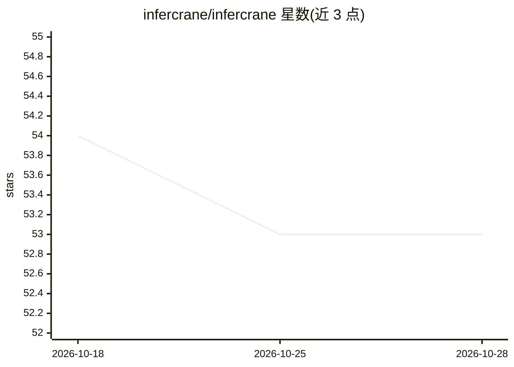

# infercrane/infercrane

⭐ 53 · Go · Apache-2.0 · 推送 2026-10-25 · [GitHub](https://github.com/infercrane/infercrane) · [官网](https://infercrane.com/) · 组织维护

**自托管模型推理的部署/观测/优化与证据门控发布系统**

面向自部署开源权重模型的推理生命周期控制面：以 CLI 与控制 API 规划并部署 vLLM、SGLang 或自定义 OCI 负载，兼容 AWS、GCP、Kubernetes、RunPod；将基础设施与版本变更收敛到一个 OpenAI 兼容稳定端点。核心机制为 Release Guard：候选项先在隔离环境以基准/回放/质量/成本证据评测，显式判定 ACCEPT/REJECT/WAIT 后才允许晋级。操作幂等、断线可恢复，请求证据不落盘提示词。本地演示无需 GPU 或云账号；真实供应商支持按精确元组限定。当前为 v1.0.0-rc.1 公测版。

## 筛选速览

| 维度 | 判定 | 备注 |
|---|---|---|
| AI 角色 | `ai-ecosystem` | LLM/agent 周边工具 |
| 许可风险 | `permissive` | Apache-2.0 |
| 部署形态 | `library` | 以包/库形式分发 |
| 模型依赖 | local-ok | 支持本地模型 |
| 硬件要求 | — | 无带数字的原话,不猜 |
| 安装摩擦 | `medium` | 含编译或系统依赖之一 |
| 成熟度 | `idea` | |

## 能力要点

- 证据门控发布：ACCEPT/REJECT/WAIT 三态决策后才显式晋级
- 在真实硬件上测量候选配置并保留合格证据（含 1.72x 吞吐提升示例）
- 幂等可恢复的持久操作，请求路径不查数据库、不存提示词
- agent 隔离沙箱：持久工作区、流式命令、睡眠/恢复与受限模型访问

## 适用场景

- 把 vLLM/SGLang 模型部署到自有云并在稳定端点后管理版本变更
- 在切流前用基准与回放证据验证新 serving 配置
- 纳管已运行的推理端点并观测其生产表现

## 场景标签

`推理引擎` `MLOps` · 领域:训练与推理

## 证据(README 行号)

> L21: InferCrane is the open-source, evidence-gated release system for open-weight inference. Deploy or
> L22: adopt vLLM and SGLang, measure serving changes against your workload, and promote only proven
> L96: - **Start where you are:** deploy vLLM, SGLang, or a custom OCI workload—or adopt a compatible

## 星数曲线

2026-10-18 54 → 2026-10-28 53（-1）

---
*卡片 v1 · prompt 1.4 · 生成 2026-10-24 · 置信度 mid · 依据 README sha `934575232141` · [字段定义](../../DATASET.md)*
