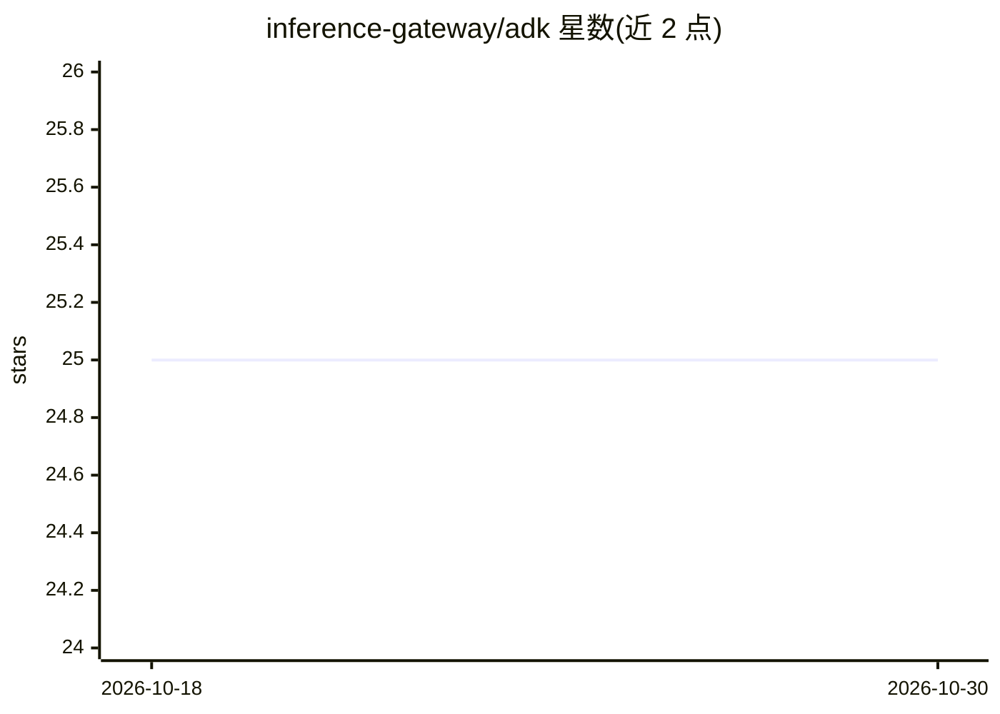

# inference-gateway/adk

⭐ 25 · Go · Apache-2.0 · 推送 2026-10-28 · [GitHub](https://github.com/inference-gateway/adk) · 组织维护

**Go 语言的 A2A 协议 Agent 开发工具包**

一个用 Go 编写的 Agent Development Kit，用于构建符合 Agent-to-Agent (A2A) 协议的智能体服务端与客户端。提供 A2A JSON-RPC 全套方法实现（任务发送、流式响应、取消、推送通知配置、扩展 Agent 卡片等），支持多 LLM 提供商接入（Anthropic、DeepSeek、Ollama、llama.cpp 等）、MCP 客户端、回调生命周期钩子、文件工件存储（文件系统/MinIO）与内存/Redis 队列后端，并集成 OpenTelemetry 观测。README 明确声明项目处于早期阶段，生产环境需使用固定版本。

## 筛选速览

| 维度 | 判定 | 备注 |
|---|---|---|
| AI 角色 | `ai-ecosystem` | LLM/agent 周边工具 |
| 许可风险 | `permissive` | Apache-2.0 |
| 部署形态 | `self-host` | docker 或自建部署 |
| 模型依赖 | local-ok | 支持本地模型 |
| 硬件要求 | — | 无带数字的原话,不猜 |
| 安装摩擦 | `low` | 无编译、无系统依赖或容器化 |
| 成熟度 | `idea` | |

## 能力要点

- A2A 协议完整实现：JSON-RPC 方法、流式响应、OIDC/OAuth2 认证、Agent 卡片发现
- 多 LLM 提供商支持（Anthropic、DeepSeek、Groq、Cohere、Ollama、llama.cpp 等）
- MCP 客户端与回调生命周期钩子（guardrails、缓存、日志）
- 文件工件（文件系统/MinIO 后端）与内存/Redis 队列存储，支持水平扩展

## 适用场景

- 用 Go 构建可与其他 AI 智能体互操作的 A2A 服务端
- 在智能体中接入 MCP 服务器的工具并通过选择器暴露
- 企业场景下的任务管理、推送通知与 OpenTelemetry 可观测部署

## 场景标签

`Agent 框架` · 领域:Agent 开发

## 证据(README 行号)

> L29: The **A2A ADK (Agent Development Kit)** is a Go library that simplifies building Agent-to-Agent (A2A) protocol comp
> L88:  Anthropic (Claude models), Cloudflare Workers AI, Cohere, DeepSeek, Elevenlabs, Google (Gemini), Groq, llama.cpp, 

## 星数曲线

2026-10-18 25 → 2026-10-30 25（+0）

---
*卡片 v1 · prompt 1.4 · 生成 2026-10-27 · 置信度 mid · 依据 README sha `424ab738652d` · [字段定义](../../DATASET.md)*
