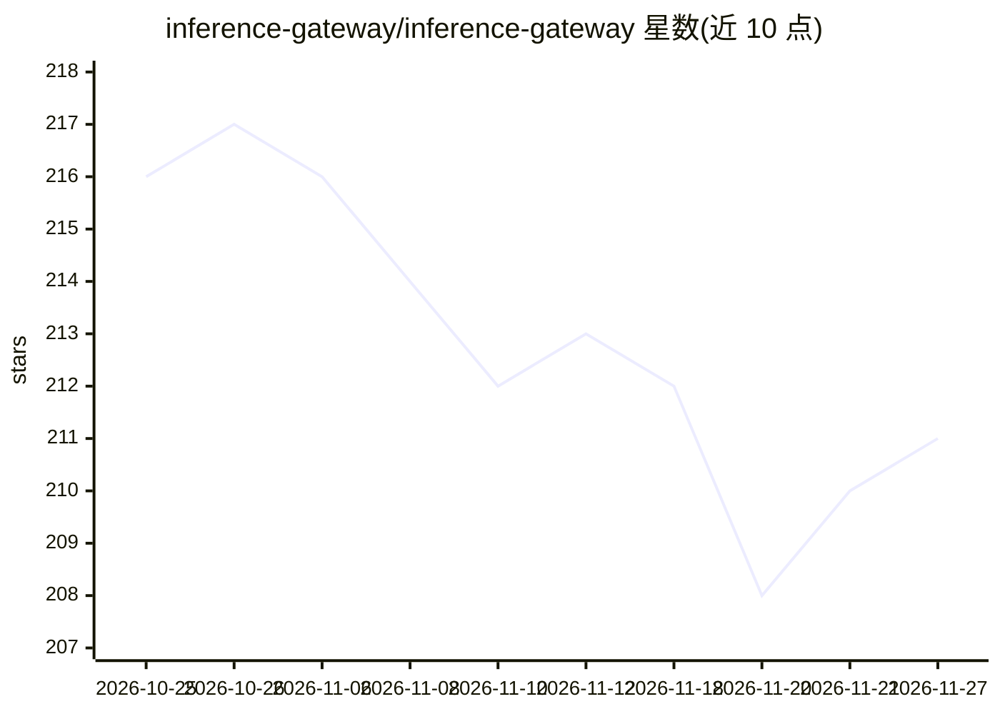

# inference-gateway/inference-gateway

⭐ 211 · Go · Apache-2.0 · 推送 2026-11-23 · [GitHub](https://github.com/inference-gateway/inference-gateway) · [官网](https://docs.inference-gateway.com) · 组织维护

**面向开发者的 LLM 多供应商统一 API 网关**

Go 编写的代理服务器，将 OpenAI、Anthropic、Groq、Cohere、Ollama、DeepSeek 等多家 LLM 供应商收拢到单一 OpenAI 兼容端点之后，按 model 前缀或查询参数推断路由。支持函数调用、流式输出、视觉多模态、MCP 工具聚合与 A2A 中继，提供 OPA/Rego 守护策略、OIDC 认证、OpenTelemetry 指标。部署形态覆盖 Docker/Compose 与 Kubernetes（含 Operator 与 HPA），压缩后约 10MB，Apache 2.0、自托管、零数据收集。

## 筛选速览

| 维度 | 判定 | 备注 |
|---|---|---|
| AI 角色 | `ai-ecosystem` | LLM/agent 周边工具 |
| 许可风险 | `permissive` | Apache-2.0 |
| 部署形态 | `desktop` | 安装包/桌面程序 |
| 模型依赖 | local-ok | 支持本地模型 |
| 硬件要求 | — | 无带数字的原话,不猜 |
| 安装摩擦 | `low` | 无编译、无系统依赖或容器化 |
| 成熟度 | — | 结构信号不足 |

## 能力要点

- 统一 OpenAI 兼容端点接入 18 家 LLM 供应商
- MCP 服务器聚合与 POST /mcp 服务端点（可选开关）
- A2A Agent-to-Agent 服务端与注册表
- OPA/Rego 守护策略、密钥与 PII 检测、OIDC 认证与 OpenTelemetry 指标

## 适用场景

- 为应用提供单一 API 入口同时访问本地与云端多家 LLM
- 在网关层统一做鉴权、限流策略与 PII 检测
- 在 Kubernetes 上水平扩展 LLM 代理服务
- 聚合多个 MCP 服务器的工具供 LLM 调用

## 场景标签

`模型网关` · 领域:Agent 开发

## 证据(README 行号)

> L27: The Inference Gateway is a proxy server designed to facilitate access to various
> L39: |🔀 **Unified API**|One OpenAI-compatible endpoint for OpenAI, Anthropic, Groq, Cohere, Ollama, Ollama Cloud, llama.
> L48: |☸️ **Kubernetes Ready**|Deploy with the Inference Gateway Operator and scale horizontally with HPA|

## 星数曲线

2026-10-25 216 → 2026-11-27 211（-5）

---
*卡片 v1 · prompt 1.4 · 生成 2026-11-25 · 置信度 high · 依据 README sha `2d1d5c3878c0` · [字段定义](../../DATASET.md)*
