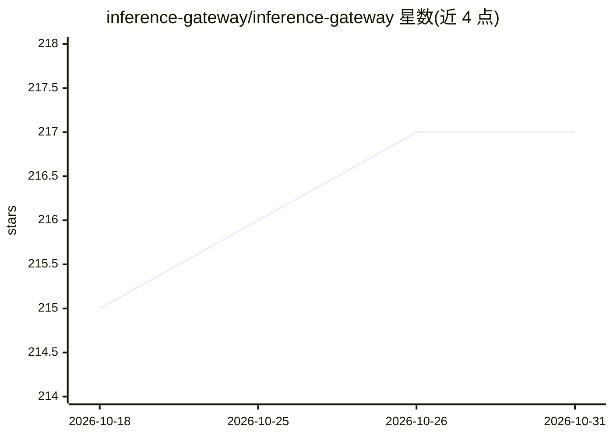

# inference-gateway/inference-gateway

⭐ 217 · Go · Apache-2.0 · 推送 2026-10-27 · [GitHub](https://github.com/inference-gateway/inference-gateway) · [官网](https://docs.inference-gateway.com) · 组织维护

**统一多家 LLM 提供商的 OpenAI 兼容 API 网关**

用 Go 编写的自托管代理服务器，将 OpenAI、Anthropic、Groq、Cohere、Ollama、llama.cpp、Cloudflare、DeepSeek、ElevenLabs、Google、Mistral、MiniMax、Moonshot、Nvidia、Z.ai、WebWright 等 16 家提供商聚合到单一 OpenAI 兼容端点之后。客户端通过 provider/model 前缀或 ?provider= 参数路由请求，支持流式输出、工具调用、视觉多模态、图像/音频/视频生成端点。内置 MCP 集成（可同时作为 MCP 服务器暴露 POST /mcp）、A2A 服务器端点、OPA/Rego 守护策略、OIDC 认证与 OpenTelemetry 指标。提供 Docker/Compose 与 Kubernetes Operator 部署方式及 CLI 工具，Apache 2.0 许可，压缩下载约 10MB。面向需要统一接入与管理多家模型服务的开发者与企业。

## 筛选速览

| 维度 | 判定 | 备注 |
|---|---|---|
| AI 角色 | `ai-ecosystem` | LLM/agent 周边工具 |
| 许可风险 | `permissive` | Apache-2.0 |
| 部署形态 | `desktop` | 安装包/桌面程序 |
| 模型依赖 | local-ok | 支持本地模型 |
| 硬件要求 | — | 无带数字的原话,不猜 |
| 安装摩擦 | `low` | 无编译、无系统依赖或容器化 |
| 成熟度 | — | 结构信号不足 |

## 能力要点

- 单一 OpenAI 兼容端点聚合 16 家 LLM 提供商（含 Ollama/llama.cpp 本地方案）
- 完整 MCP 集成：自动发现并暴露 MCP 工具，网关自身可作为 MCP 服务器（POST /mcp）
- OPA/Rego 守护策略、PII 检测、OIDC 认证与 OpenTelemetry 可观测性
- 覆盖图像生成、语音合成（含本地 llama.cpp qwen3-tts）、音效、音乐与视频生成端点

## 适用场景

- 在多个 LLM 提供商之间统一 API 接入，避免逐家适配
- 自托管网关并对请求/响应施加守护策略与 PII 检测
- 在 Kubernetes 上用 Operator 部署并水平扩展 LLM 流量
- 将 MCP 服务器工具统一聚合给 LLM 客户端使用

## 场景标签

`模型网关` · 领域:Agent 开发

## 证据(README 行号)

> L5:  An open-source, cloud-native, high-performance gateway unifying multiple LLM providers behind one OpenAI-compatible
> L27: The Inference Gateway is a proxy server designed to facilitate access to various
> L39: |🔀 **Unified API**|One OpenAI-compatible endpoint for OpenAI, Anthropic, Groq, Cohere, Ollama, Ollama Cloud, llama.

## 星数曲线

2026-10-18 215 → 2026-10-31 217（+2）

---
*卡片 v1 · prompt 1.4 · 生成 2026-10-23 · 置信度 high · 依据 README sha `13481587dff0` · [字段定义](../../DATASET.md)*
