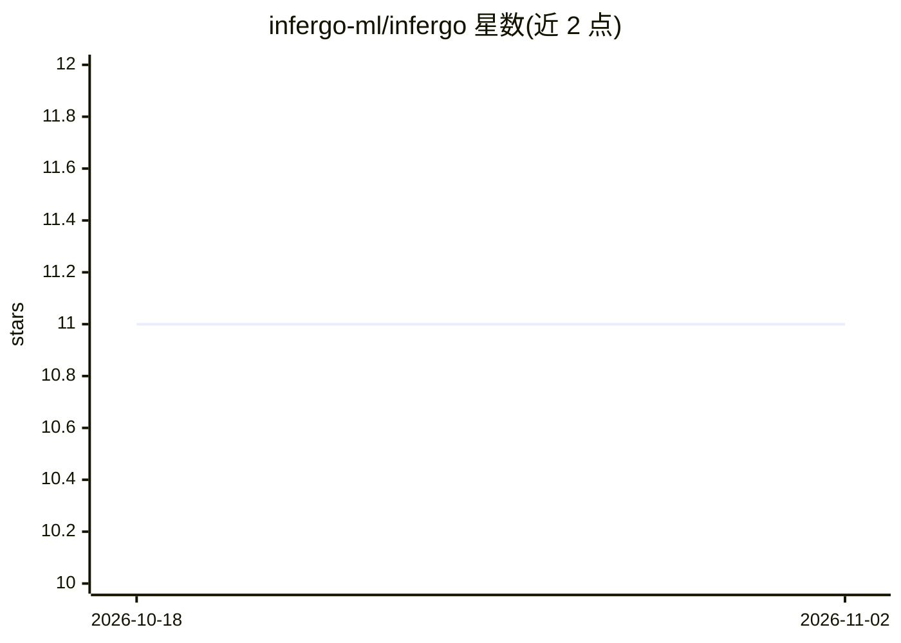

# infergo-ml/infergo

⭐ 11 · Go · MIT · 推送 2025-11-27 · [GitHub](https://github.com/infergo-ml/infergo) · 个人维护

**Go 语言的概率编程库：用 Go 写模型做推断**

infergo 是面向 Go 语言的概率编程设施：允许以接近不受限制的 Go 代码编写概率模型，依托自动微分完成优化与推断。README 中给出从观测数据学习正态分布参数的示例，包含模型定义与推断代码两部分。项目由个人开发者维护，其就职公司 PUB+ 支持开发并在生产环境中用于关键决策的概率编程应用。示例之外的具体推断算法与安装方式在可见 README 中未展开。

## 筛选速览

| 维度 | 判定 | 备注 |
|---|---|---|
| AI 角色 | `ai-native` | 本体是模型或模型工具 |
| 许可风险 | `permissive` | MIT |
| 部署形态 | `None` |  |
| 模型依赖 | — | README 未给出锁定关系 |
| 硬件要求 | — | 无带数字的原话,不猜 |
| 安装摩擦 | `low` | 无编译、无系统依赖或容器化 |
| 成熟度 | — | 结构信号不足 |

## 能力要点

- 以接近不受限制的 Go 编写概率模型
- 基于自动微分实现优化与推断
- 提供正态分布参数学习的示例代码

## 适用场景

- 在 Go 项目中编写并推断概率模型
- 从观测数据学习分布参数
- 在生产环境中应用概率编程做决策支持

## 场景标签

 · 领域:机器学习/概率编程

## 证据(README 行号)

> L3: `infergo` is a probabilistic programming
> L6: and relies on [automatic
> L7: differentiation](https://en.wikipedia.org/wiki/Automatic_differentiation)

## 星数曲线

2026-10-18 11 → 2026-11-02 11（+0）

---
*卡片 v1 · prompt 1.4 · 生成 2026-11-02 · 置信度 high · 依据 README sha `29732417e958` · [字段定义](../../DATASET.md)*
