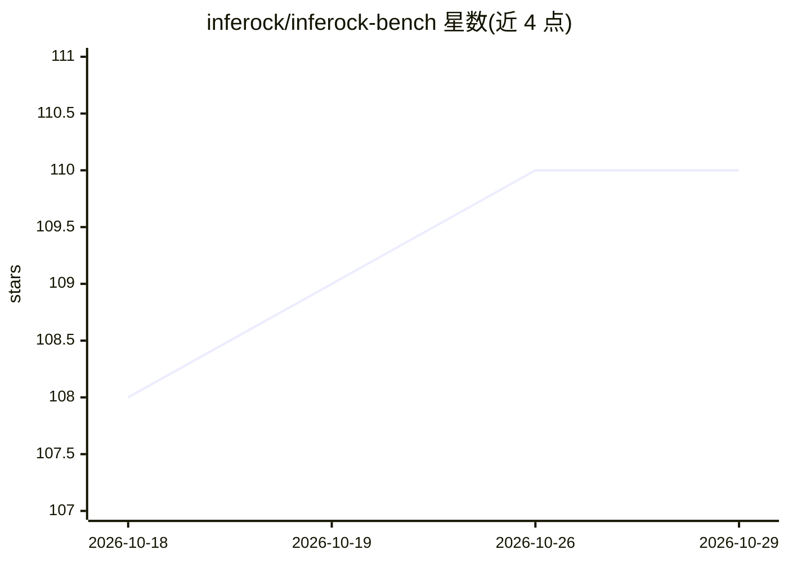

# inferock/inferock-bench

⭐ 110 · TypeScript · NOASSERTION · 推送 2026-08-17 · [GitHub](https://github.com/inferock/inferock-bench) · [官网](https://inferock.ai) · 组织维护

**本地 LLM API 计费审计代理：按调用生成账单凭证**

面向开发者与企业的本地诊断代理：在 localhost 拦截经其路由的 OpenAI、Anthropic、Gemini 与固定 OpenRouter 端点的计量 API 流量，记录供应商上报的用量、状态、重试与失败信号（如计费空输出、截断、token 复核不符），经 @inferock/measure 评分代码渲染逐调用收据，区分花费、计费内损失、时间损失与发票核查敞口。密钥仅存本地。限制：无法审计绕过代理的流量，非供应商排名；供应商 Inferock 另售托管产品。以 npx 安装运行，需 Node.js 22+。

## 筛选速览

| 维度 | 判定 | 备注 |
|---|---|---|
| AI 角色 | `ai-ecosystem` | LLM/agent 周边工具 |
| 许可风险 | `none` | NOASSERTION |
| 部署形态 | `library` | 以包/库形式分发 |
| 模型依赖 | locked-api |  |
| 硬件要求 | — | 无带数字的原话,不猜 |
| 安装摩擦 | `low` | 无编译、无系统依赖或容器化 |
| 成熟度 | — | 结构信号不足 |

## 能力要点

- 本地代理拦截四类供应商平面（OpenAI/Anthropic/Gemini/OpenRouter 固定端点）的计量调用
- 逐调用收据区分 spent/money loss/time loss/invoice-check exposure，不加总不同口径数字
- 检测计费空输出、拒绝、截断、token 复核不符、重复请求 ID 等可影响账单的失败
- 供应商密钥仅存本地（~/.inferock-bench/，owner-only 权限），不发送给 Inferock

## 适用场景

- 审计 AI/LLM 账单，核对失败调用是否被计费
- 本地测量 Claude/GPT 等供应商 API 的 token 用量与交付失败
- 保存逐调用计费证据以备账单争议核查

## 场景标签

`LLM 可观测性` · 领域:评测与运维

## 证据(README 行号)

> L35: Use it when you need to audit an AI/LLM bill, measure Claude or GPT token usage locally, or answer "was I billed fo
> L39: `inferock-bench` is a local diagnostic proxy for metered API traffic. It measures calls routed through localhost wi

## 星数曲线

2026-10-18 108 → 2026-10-29 110（+2）

---
*卡片 v1 · prompt 1.4 · 生成 2026-10-23 · 置信度 high · 依据 README sha `02222871b607` · [字段定义](../../DATASET.md)*
