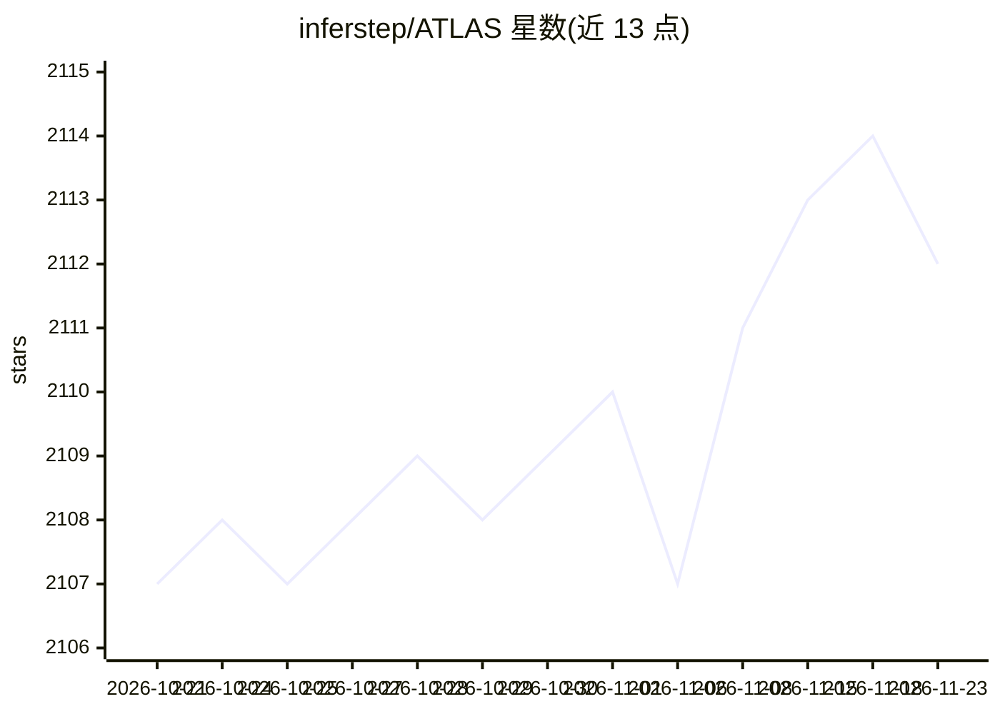

# inferstep/ATLAS

⭐ 2,112 · Python · AGPL-3.0 · 推送 2026-11-16 · [GitHub](https://github.com/inferstep/ATLAS) · [官网](https://inferstep.com) · 组织维护

**本地编码 agent：让小模型在自己硬件上完成软件工作**

自托管的本地编码 agent，围绕 GGUF 小模型构建规划、候选生成、质量评分、沙箱测试与修复的系统层。组件包括 Bubbletea TUI 客户端、Go 编写的 agent 代理、多阶段 V3 生成管线、基于嵌入的能量评分 Lens，以及多语言沙箱执行环境。通过 llama-server 在消费级 GPU 上做量化推理，无需托管 API 或第三方 key。README 声明状态为实验性，3.1 版本存在已知缺陷，官方基准数字已撤回。

## 筛选速览

| 维度 | 判定 | 备注 |
|---|---|---|
| AI 角色 | `ai-native` | 本体是模型或模型工具 |
| 许可风险 | `viral` | AGPL-3.0 |
| 部署形态 | `self-host` | docker 或自建部署 |
| 模型依赖 | local-ok | 支持本地模型 |
| 硬件要求 | — | 无带数字的原话,不猜 |
| 安装摩擦 | `low` | 无编译、无系统依赖或容器化 |
| 成熟度 | `idea` | |

## 能力要点

- V3 多阶段管线：PlanSearch 规划、DivSampling 多候选、PR-CoT 自修复与沙箱迭代
- Geometric Lens 基于模型自身嵌入做候选评分，无需外部 oracle
- 支持 NVIDIA CUDA、AMD ROCm、Apple Metal、Vulkan 与 CPU 的 GGUF 量化推理
- 沙箱默认禁止外网（ATLAS_SANDBOX_NET_INTERNAL=true）

## 适用场景

- 在无 API key 的本地硬件上运行编码 agent 完成代码修改
- 为自托管模型构建生成-验证-修复的闭环工作流
- 针对自有工作负载训练 Lens 与 ASA 校准工件

## 场景标签

`编码 Agent` · 领域:编码与开发

## 证据(README 行号)

> L26: **ATLAS is a local coding agent that brings frontier-style reasoning and verification to compact open models.** It 
> L33: * **Run your own model.** Use a compatible GGUF model on NVIDIA, AMD, Apple Silicon, Vulkan, or CPU-supported hardw
> L73: 3. **V3 Pipeline** - multi-phase code generation; turns a single prompt into a verified candidate.

## 星数曲线

2026-10-21 2,107 → 2026-11-23 2,112（+5）

---
*卡片 v1 · prompt 1.4 · 生成 2026-11-23 · 置信度 high · 依据 README sha `1734a5f99ccb` · [字段定义](../../DATASET.md)*
