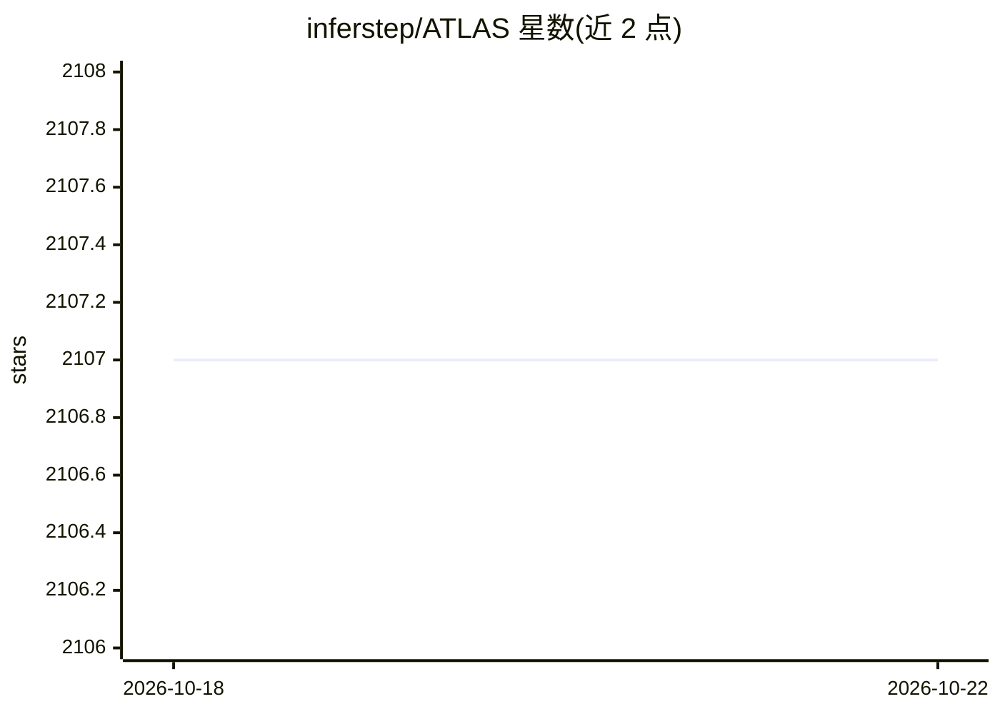

# inferstep/ATLAS

⭐ 2,107 · Python · AGPL-3.0 · 推送 2026-10-20 · [GitHub](https://github.com/inferstep/ATLAS) · [官网](https://inferstep.com) · 组织维护

**本地自托管的编码 agent：让小模型完成真实软件工作**

ATLAS 是运行在本地硬件上的编码 agent 系统，围绕紧凑 GGUF 模型构建规划、候选生成、质量评分、沙箱测试与修复等系统层能力，使小模型可在无托管 API、无按 token 计费的情况下处理软件任务。组件包括 Bubbletea TUI、Go 编排代理、V3 多阶段代码生成管线、基于模型自身嵌入的 Geometric Lens 评分、多语言沙箱和 llama-server 本地推理（CUDA/ROCm/Metal/Vulkan）。要求 16GB+ VRAM GPU，一键脚本或 Docker/Podman 部署，需约 20GB 磁盘。项目自声明为 experimental，3.1 线验证存在已知缺口（如失败候选可被写为已验证），当前无可用的基准测试结果（V3.0 LiveCodeBench 数字已撤回）。

## 筛选速览

| 维度 | 判定 | 备注 |
|---|---|---|
| AI 角色 | `ai-native` | 本体是模型或模型工具 |
| 许可风险 | `viral` | AGPL-3.0 |
| 部署形态 | `self-host` | docker 或自建部署 |
| 模型依赖 | local-ok | 支持本地模型 |
| 硬件要求 | — | 无带数字的原话,不猜 |
| 安装摩擦 | `low` | 无编译、无系统依赖或容器化 |
| 成熟度 | `idea` | |

## 能力要点

- 围绕模型构建规划/候选/评分/沙箱验证/修复的系统层
- llama-server 本地量化推理（Q6_K/Q4_K_M），支持 NVIDIA CUDA、AMD ROCm、Apple Metal、Vulkan
- Geometric Lens 基于模型自身嵌入的候选质量评分，无需第二个模型
- 一键 bootstrap 脚本检测发行版与 GPU 并自动部署（约 10-30 分钟）

## 适用场景

- 在自有 GPU 上本地运行编码 agent，不依赖托管 API
- 让紧凑开源模型处理真实软件任务并经沙箱编译测试验证
- 用自带 TUI 在项目目录中对话式管理代码编辑与提交

## 场景标签

`编码 Agent` · 领域:编码与开发

## 证据(README 行号)

> L26: **ATLAS is a local coding agent that brings frontier-style reasoning and verification to compact open models.** It 
> L90: 6. **llama-server** - local LLM inference on one consumer GPU.

## 星数曲线

2026-10-18 2,107 → 2026-10-22 2,107（+0）

---
*卡片 v1 · prompt 1.4 · 生成 2026-10-21 · 置信度 high · 依据 README sha `eecbb4d3437a` · [字段定义](../../DATASET.md)*
