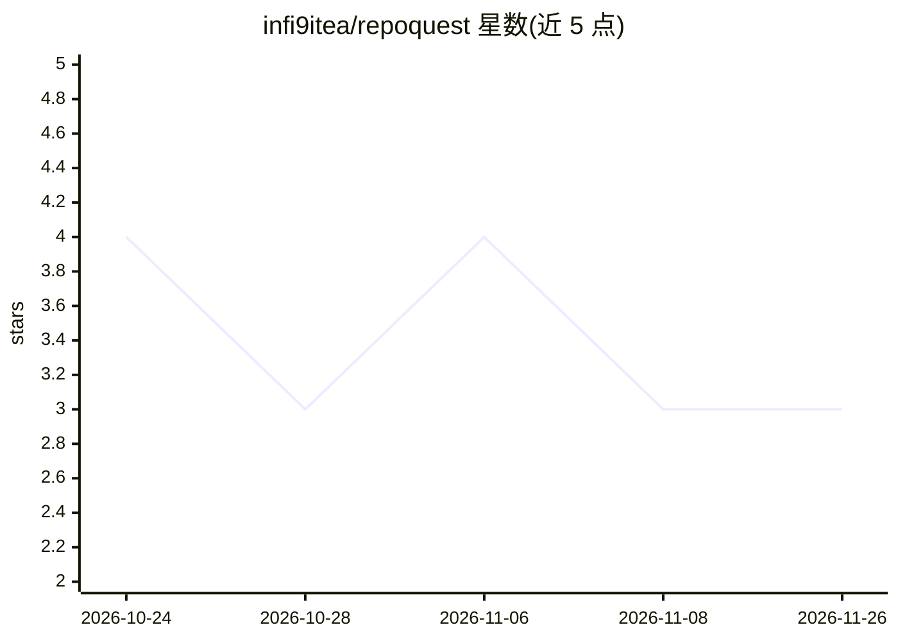

# infi9itea/repoquest

⭐ 3 · TypeScript · MIT · 推送 2026-10-26 · [GitHub](https://github.com/infi9itea/repoquest) · [官网](https://repo-quest-five.vercel.app) · 个人维护

**面向开发者：把 GitHub 仓库生成三个引导式探索任务**

RepoQuest 将公开 GitHub 仓库转换为三个带调查目标、具体步骤、成功标准的引导任务，链接到真实 issue 与实际存在的源码路径。生成流程：Next.js /api/generate 路由从 GitHub REST API 抓取仓库元数据、最近五个开放 issue 与文件路径索引，发给 Gemini 生成 JSON，并在到达 UI 前校验 issue 编号、URL 与文件路径的真实性。进度与快照存于浏览器 localStorage。限制：仅支持公开仓库、不读取文件内容、速率限制在内存中冷启动即重置。

## 筛选速览

| 维度 | 判定 | 备注 |
|---|---|---|
| AI 角色 | `ai-native` | 本体是模型或模型工具 |
| 许可风险 | `permissive` | MIT |
| 部署形态 | `None` |  |
| 模型依赖 | — | README 未给出锁定关系 |
| 硬件要求 | — | 无带数字的原话,不猜 |
| 安装摩擦 | `low` | 无编译、无系统依赖或容器化 |
| 成熟度 | — | 结构信号不足 |

## 能力要点

- 从任意公开 GitHub 仓库生成三个引导式探索任务
- 模型输出经校验：issue 必须存在于抓取数据、路径必须在索引中
- 浏览器端进度追踪与工作区快照（localStorage）
- 提供 Vercel 在线演示与部署方式

## 适用场景

- 加入开源项目前快速了解陌生代码库的结构与待办 issue
- 为新人设计代码库上手路径
- 挑选真实 issue 作为练手任务

## 场景标签

`教程课程` · 领域:学习与行业

## 证据(README 行号)

> L21: 3. It sends that evidence to Google Gemini and asks for exactly three quests as JSON.
> L22: 4. The response is validated before it reaches the UI: issue numbers must exist in the fetched data, issue URLs com

## 星数曲线

2026-10-24 4 → 2026-11-26 3（-1）

---
*卡片 v1 · prompt 1.4 · 生成 2026-11-21 · 置信度 high · 依据 README sha `0d556d4dc2ac` · [字段定义](../../DATASET.md)*
