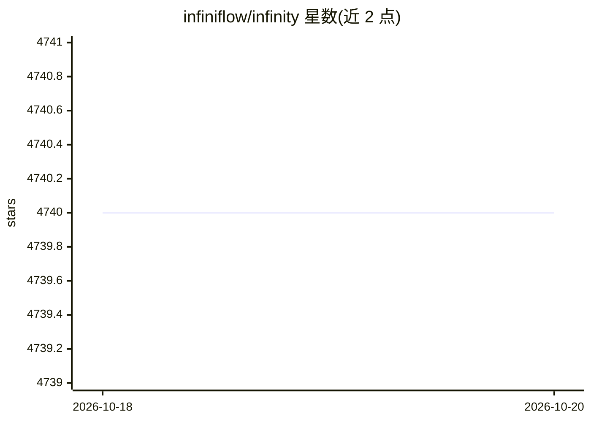

# infiniflow/infinity

⭐ 4,740 · C++ · Apache-2.0 · 推送 2026-10-17 · [GitHub](https://github.com/infiniflow/infinity) · [官网](https://infiniflow.org) · 组织维护

**面向 LLM 应用的 AI 原生数据库，提供向量/全文混合检索**

Infinity 是用 C++20 编写的数据库，面向 LLM 与 RAG 应用场景，支持稠密向量、稀疏向量、tensor（多向量）、全文与结构化数据的混合检索，并提供 RRF、加权求和、ColBERT 等重排器。README 给出的性能数字：百万级向量数据集 0.1 毫秒查询延迟、15K+ QPS；3300 万文档全文检索 1 毫秒延迟、12K+ QPS。以 Python API 使用，可嵌入式作为 Python 模块，也可单二进制/Docker 部署客户端-服务端架构。硬件要求 x86_64 AVX2，支持 Linux/Windows(WSL)/macOS，Python 3.11+。

## 筛选速览

| 维度 | 判定 | 备注 |
|---|---|---|
| AI 角色 | `ai-ecosystem` | LLM/agent 周边工具 |
| 许可风险 | `permissive` | Apache-2.0 |
| 部署形态 | `self-host` | docker 或自建部署 |
| 模型依赖 | — | README 未给出锁定关系 |
| 硬件要求 | — | 无带数字的原话,不猜 |
| 安装摩擦 | `low` | 无编译、无系统依赖或容器化 |
| 成熟度 | — | 结构信号不足 |

## 能力要点

- 稠密/稀疏向量、tensor、全文的混合检索与过滤
- 多种重排器：RRF、加权求和、ColBERT
- 单二进制无依赖架构，可嵌入式 Python 模块或 Docker 部署
- README 数字：百万级向量 0.1ms 延迟 15K+ QPS；3300 万文档全文 1ms/12K+ QPS

## 适用场景

- 为 RAG 应用提供向量与全文混合检索后端
- 构建搜索、推荐、问答、对话式 AI 应用的存储与检索层
- 用 Python 嵌入方式在开发环境中快速集成数据库

## 场景标签

`向量数据库` · 领域:知识与检索

## 证据(README 行号)

> L10: Infinity is a cutting-edge AI-native database that provides a wide range of search capabilities for rich data types
> L31: - Supports a hybrid search of dense embedding, sparse embedding, tensor, and full text, in addition to filtering.

## 星数曲线

2026-10-18 4,740 → 2026-10-20 4,740（+0）

---
*卡片 v1 · prompt 1.4 · 生成 2026-10-20 · 置信度 high · 依据 README sha `1e0ea65b7350` · [字段定义](../../DATASET.md)*
