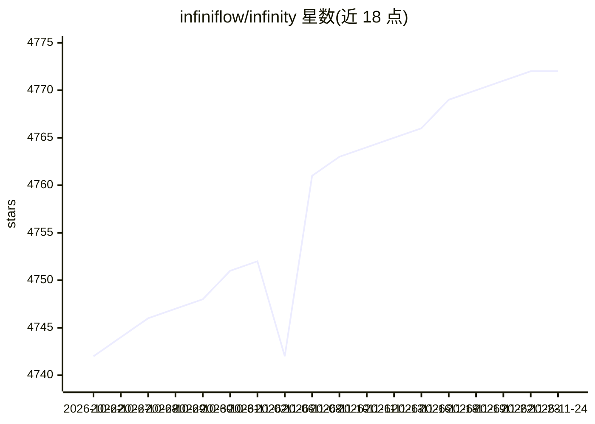

# infiniflow/infinity

⭐ 4,772 · C++ · Apache-2.0 · 推送 2026-11-22 · [GitHub](https://github.com/infiniflow/infinity) · [官网](https://infiniflow.org) · 组织维护

**面向 LLM/RAG 应用的 AI 原生混合搜索数据库**

Infinity 是一款 AI 原生数据库，提供稠密向量、稀疏向量、tensor（多向量）与全文检索的混合搜索，以及结构化数据处理，服务搜索、推荐、问答、对话式 AI、copilot、内容生成等 RAG 应用。技术特性包括 0.1 毫秒级向量查询延迟、RRF/加权求和/ColBERT 等重排方式、Python API，以及单二进制无依赖架构，也可作为 Python 模块嵌入。服务器通过 Docker 或二进制部署，客户端经 pip 安装 SDK；要求支持 AVX2 的 x86_64 CPU。

## 筛选速览

| 维度 | 判定 | 备注 |
|---|---|---|
| AI 角色 | `ai-ecosystem` | LLM/agent 周边工具 |
| 许可风险 | `permissive` | Apache-2.0 |
| 部署形态 | `self-host` | docker 或自建部署 |
| 模型依赖 | — | README 未给出锁定关系 |
| 硬件要求 | — | 无带数字的原话,不猜 |
| 安装摩擦 | `low` | 无编译、无系统依赖或容器化 |
| 成熟度 | — | 结构信号不足 |

## 能力要点

- 稠密/稀疏向量、tensor、全文的混合搜索与过滤
- 支持 RRF、加权求和、ColBERT 等重排方式
- 单二进制无依赖架构，可嵌入 Python 作为模块
- Docker/pip/源码多种部署与安装途径

## 适用场景

- 为 RAG 应用搭建混合检索后端
- 构建问答与对话式 AI 的向量检索服务
- 搭建推荐或内容生成应用的检索组件

## 场景标签

`RAG` `语义搜索` `向量数据库` · 领域:知识与检索

## 证据(README 行号)

> L10: Infinity is a cutting-edge AI-native database that provides a wide range of search capabilities for rich data types
> L41: - A single-binary architecture with no dependencies, making deployment a breeze.

## 星数曲线

2026-10-22 4,742 → 2026-11-24 4,772（+30）

---
*卡片 v1 · prompt 1.4 · 生成 2026-11-22 · 置信度 high · 依据 README sha `3746622ee067` · [字段定义](../../DATASET.md)*
