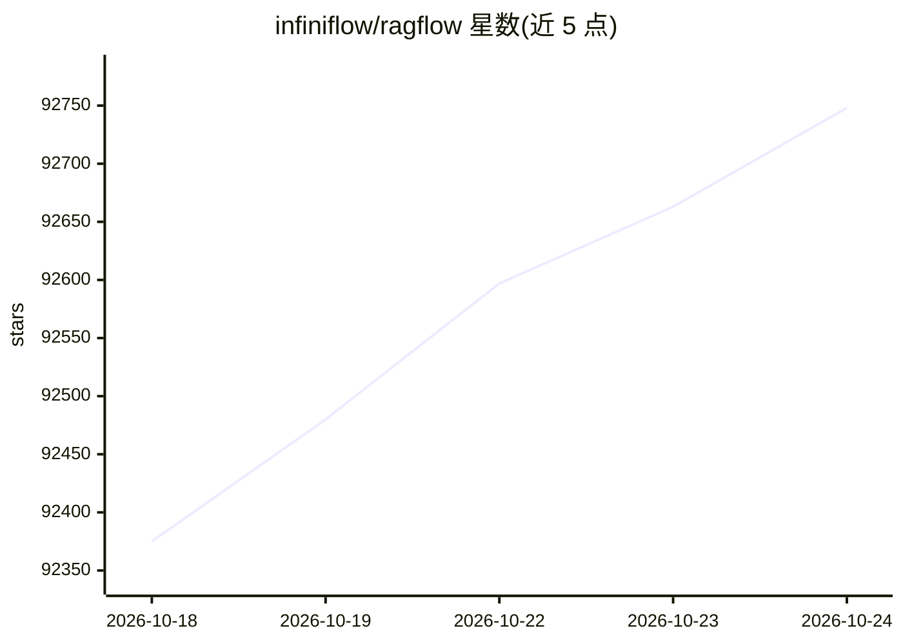

# infiniflow/ragflow

⭐ 92,748 · Go · Apache-2.0 · 推送 2026-10-23 · [GitHub](https://github.com/infiniflow/ragflow) · [官网](https://ragflow.io) · 组织维护 · 中文 README

**企业级开源 RAG 引擎：融合 Agent 能力为 LLM 提供上下文层**

RAGFlow 是 infiniflow 维护的开源检索增强生成引擎，结合 Agent 能力为 LLM 提供上下文层。核心机制包括基于模板的分块、文档/数据集级知识编译（生成 Wiki、图谱、树、思维导图等）、多步 Agentic 检索（Low 到 Ultra 四档思考模式）、可追溯引用的可视化分块。支持 Word、PDF、网页等异构数据源接入，提供 API 集成。本地部署支持 Docker 或源码构建，另提供 cloud.ragflow.io 云服务。注意源码构建依赖 Go 1.27、Clang 20 等工具链。

## 筛选速览

| 维度 | 判定 | 备注 |
|---|---|---|
| AI 角色 | `ai-native` | 本体是模型或模型工具 |
| 许可风险 | `permissive` | Apache-2.0 |
| 部署形态 | `self-host` | docker 或自建部署 |
| 模型依赖 | — | README 未给出锁定关系 |
| 硬件要求 | — | 无带数字的原话,不猜 |
| 安装摩擦 | `low` | 无编译、无系统依赖或容器化 |
| 成熟度 | — | 结构信号不足 |

## 动量与使用信号

- 维护:`active` — 距上次 push 0.8 天,年发版 24,454 位贡献者
- 涨星:近 1 天 **+58**(自 20261016 起算)

## 能力要点

- 模板化分块与文档可视化干预，引用可溯源
- 知识编译生成 Wiki、Graph、Tree、PageIndex 等结构化产物
- Agentic 检索支持 Low/Medium/High/Ultra 四档思考模式
- 支持 Word/PPT/Excel/PDF/网页等多格式数据源

## 适用场景

- 为企业知识库搭建检索增强问答系统
- 对复杂格式文档做深度理解与知识提取
- 用预置 Agent 模板构建生产级 AI 应用
- 通过 API 将 RAG 能力集成到业务系统

## 场景标签

`RAG` `Agent 框架` · 领域:Agent 开发

## 证据(README 行号)

> L57: RAGFlow is a leading open-source Retrieval-Augmented Generation (RAG) engine that fuses cutting-edge RAG with Agent
> L131: Local deployment supports both Docker deployment and launching from source. Docker is suitable for quick evaluatio

## 星数曲线

2026-10-18 92,375 → 2026-10-24 92,748（+373）

---
*卡片 v1 · prompt 1.4 · 生成 2026-10-18 · 置信度 mid · 依据 README sha `b33840486af5` · [字段定义](../../DATASET.md)*
