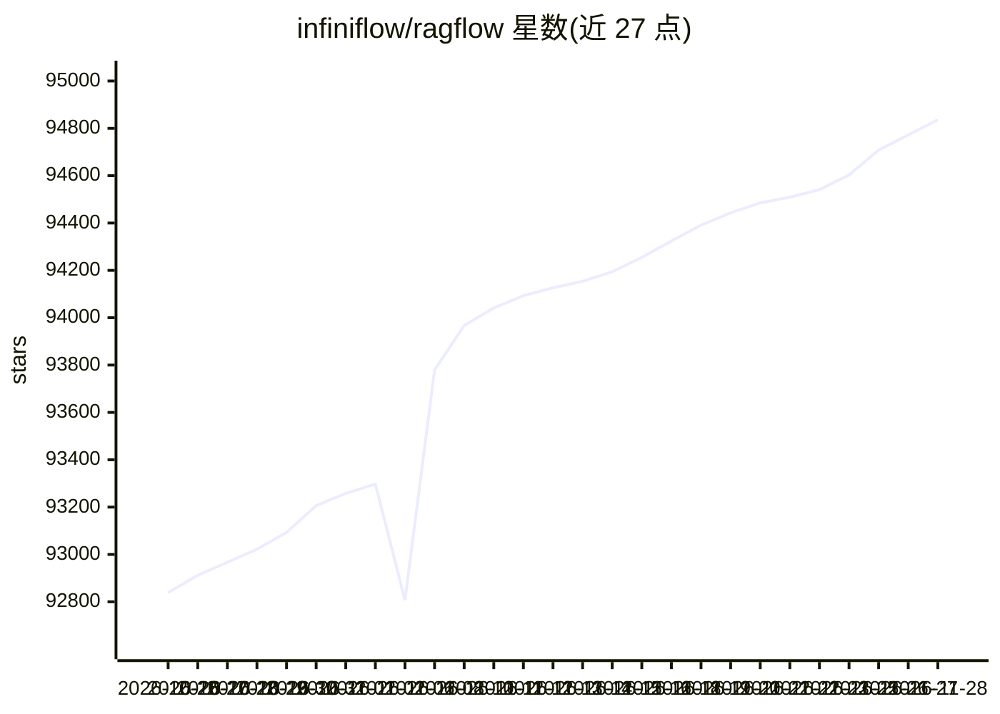

# infiniflow/ragflow

⭐ 94,836 · Go · Apache-2.0 · 推送 2026-11-27 · [GitHub](https://github.com/infiniflow/ragflow) · [官网](https://ragflow.io) · 组织维护 · 中文 README

**开源 RAG 引擎与 agent 基础设施：将复杂数据转为可用的 AI 系统**

RAGFlow 自述为一个 agent-native 数据库与检索增强生成（RAG）引擎，为 LLM 提供上下文层。核心机制包括基于深度文档理解的模板化分块、文档与数据集级知识编译（生成 Wiki、图、树、思维导图等）、多步 agentic 检索（Low/Medium/High/Ultra 思考模式）、带可追溯引用的接地回答。支持 Docker 部署或源码启动（Go 服务，需 CGO 编译），通过 Web UI 配置 LLM、embedding 与 reranker 模型。macOS 平台暂不支持。

## 筛选速览

| 维度 | 判定 | 备注 |
|---|---|---|
| AI 角色 | `ai-ecosystem` | LLM/agent 周边工具 |
| 许可风险 | `permissive` | Apache-2.0 |
| 部署形态 | `self-host` | docker 或自建部署 |
| 模型依赖 | — | README 未给出锁定关系 |
| 硬件要求 | — | 无带数字的原话,不猜 |
| 安装摩擦 | `low` | 无编译、无系统依赖或容器化 |
| 成熟度 | — | 结构信号不足 |

## 动量与使用信号

- 维护:`active` — 距上次 push 0.8 天,年发版 24,454 位贡献者
- 涨星:近 1 天 **+58**(自 20261016 起算)

## 能力要点

- 模板化分块与可视化 chunk 校对，支持人工干预
- 知识编译：从文档/数据集生成 Wiki、Graph、Tree、PageIndex、Mind Map、Timeline、Skills
- Agentic 检索支持四档思考深度控制推理强度
- 兼容 Word、PPT、Excel、PDF、扫描件、网页等异构数据源

## 适用场景

- 为企业搭建私有知识库问答系统
- 对复杂格式文档做深度解析与知识提取
- 通过 API 将 RAG 能力集成到业务系统
- 构建带多步检索的 agent 工作流

## 场景标签

`RAG` `文档问答` `文档解析` · 领域:知识与检索

## 证据(README 行号)

> L57: RAGFlow is a leading open-source Retrieval-Augmented Generation (RAG) engine that fuses cutting-edge RAG with Agent
> L126: Local deployment supports both Docker deployment and launching from source. Docker is suitable for quick evaluatio
> L132: - Recommended starting configuration: 4 CPU cores, 16 GB RAM, and 50 GB of available disk space. Actual requiremen

## 星数曲线

2026-10-26 92,839 → 2026-11-28 94,836（+1,997）

---
*卡片 v1 · prompt 1.4 · 生成 2026-11-22 · 置信度 mid · 依据 README sha `27a788bd6f88` · [字段定义](../../DATASET.md)*
