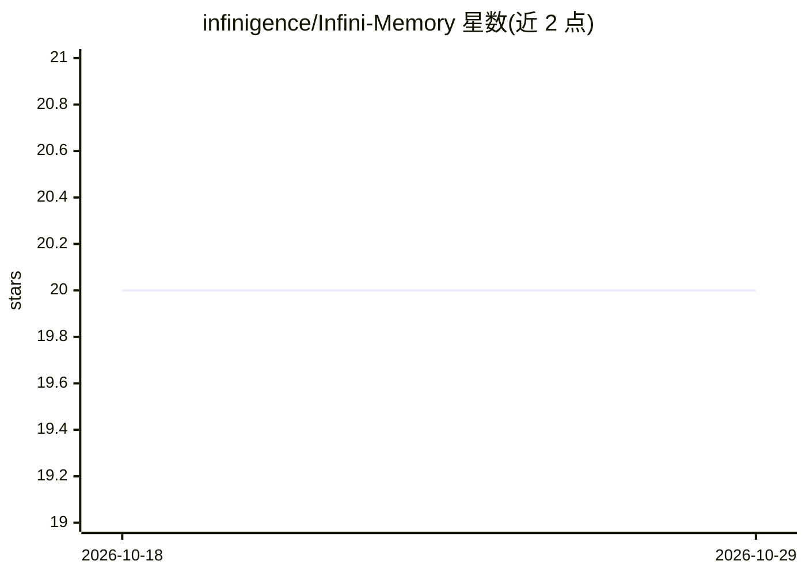

# infinigence/Infini-Memory

⭐ 20 · Python · Apache-2.0 · 推送 2026-09-01 · [GitHub](https://github.com/infinigence/Infini-Memory) · 组织维护 · 中文 README

**面向 LLM agent 的文本化持久记忆架构，按主题文档组织**

为长期运行的 LLM agent 提供持久记忆的 Python 库：将记忆表示为按主题组织的 Markdown 文档，通过写入、维护、读取三个耦合操作处理碎片化、冲突、压缩损失与检索不足问题。写入路径先追加到 CURRENT 缓冲，再周期性重写/拆分/合并为主题文档；读取支持 LLM 摘要+BM25 混合检索与 agent 迭代调用记忆工具的检索两种方式。存储支持本地文件系统（默认）与 S3 兼容对象存储，需要 LLM 才能运行，默认 gpt-5-mini。

## 筛选速览

| 维度 | 判定 | 备注 |
|---|---|---|
| AI 角色 | `ai-ecosystem` | LLM/agent 周边工具 |
| 许可风险 | `permissive` | Apache-2.0 |
| 部署形态 | `library` | 以包/库形式分发 |
| 模型依赖 | — | README 未给出锁定关系 |
| 硬件要求 | — | 无带数字的原话,不猜 |
| 安装摩擦 | `low` | 无编译、无系统依赖或容器化 |
| 成熟度 | — | 结构信号不足 |

## 能力要点

- 记忆以主题结构化 Markdown 文档为载体，不依赖向量或图数据库
- 缓冲写入+周期性整理（重写/拆分/更新/合并）的生命周期维护机制
- 混合检索（LLM 摘要+BM25）与 Agentic 检索（grep/search 等工具迭代）两种读取变体
- 可插拔存储：本地文件系统与 S3 兼容对象存储（SeaweedFS/MinIO/AWS S3）

## 适用场景

- 为长期对话 agent 跨会话保存和更新用户事实与偏好
- 多轮记忆整理中解决新旧观察冲突与证据碎片化
- 需要可追溯时间与来源标注的记忆存证场景

## 场景标签

`Agent 记忆` · 领域:Agent 开发

## 证据(README 行号)

> L10: A maintainable, text-based persistent memory architecture that organizes LLM agent memory as topic-structured docum
> L23: Infini Memory addresses these by treating persistent memory as a **lifecycle maintenance problem** with three coupl
> L32: For AI Agent applications, use the `infini_agent_memory` module. It provides a small Pydantic API over the separate

## 星数曲线

2026-10-18 20 → 2026-10-29 20（+0）

---
*卡片 v1 · prompt 1.4 · 生成 2026-10-28 · 置信度 high · 依据 README sha `4aed05d94fa8` · [字段定义](../../DATASET.md)*
