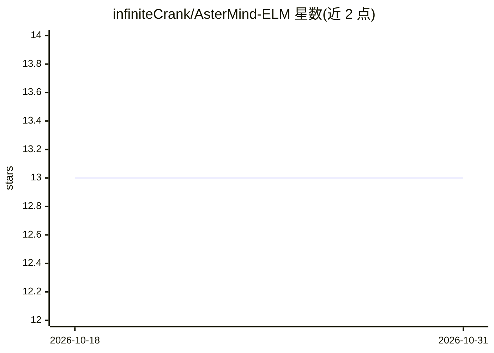

# infiniteCrank/AsterMind-ELM

⭐ 13 · TypeScript · NOASSERTION · 推送 2026-01-16 · [GitHub](https://github.com/infiniteCrank/AsterMind-ELM) · [官网](https://AsterMind.ai) · 个人维护

**浏览器/Node 端极限学习机（ELM）JS/TS 库，设备上训练与预测**

面向 JS/TS（浏览器+Node）的模块化 Extreme Learning Machine 库：提供 ELM、Kernel ELM（Exact/Nyström，RBF/Linear/Poly/Laplacian/自定义核）、Online ELM（RLS 流式更新）、DeepELM（多层堆叠）与 ELMChain 链式嵌入；训练为闭式解（ridge/伪逆），支持 Web Worker 线程外训练、JSON 导入导出、EmbeddingStore 向量检索、TFIDF/KNN 与预置模块（IntentClassifier、AutoComplete 等）。以 ESM+UMD 双格式发布，通过 npm/CDN 安装，声明无需 GPU 与服务器。IO 工具为实验性。

## 筛选速览

| 维度 | 判定 | 备注 |
|---|---|---|
| AI 角色 | `ai-native` | 本体是模型或模型工具 |
| 许可风险 | `permissive` | NOASSERTION |
| 部署形态 | `library` | 以包/库形式分发 |
| 模型依赖 | — | README 未给出锁定关系 |
| 硬件要求 | — | 无带数字的原话,不猜 |
| 安装摩擦 | `low` | 无编译、无系统依赖或容器化 |
| 成熟度 | — | 结构信号不足 |

## 能力要点

- 闭式训练（ridge/伪逆），无需 SGD 与 GPU
- Kernel ELM（Exact/Nyström+白化）、Online ELM（RLS 遗忘因子）、DeepELM 三种扩展
- Web Worker 适配器实现主线程外训练/预测
- EmbeddingStore 向量库（cosine/dot/euclidean KNN）与 JSON 模型持久化

## 适用场景

- 在网页中做设备端私有分类/意图识别并按用户反馈重训
- 用 ELM 嵌入构建轻量检索与重排序
- 构建堆叠式深度 ELM 流水线

## 场景标签

 · 领域:机器学习/前端智能

## 证据(README 行号)

> L7: A modular Extreme Learning Machine (ELM) library for JS/TS (browser + Node).
> L99: - ✅ Closed-form training (ridge / pseudoinverse)
> L227: - `train`, `trainFromData`, `predict`, `predictFromVector`, `getEmbedding`, **`predictLogitsFromVectors`**, JSON I

## 星数曲线

2026-10-18 13 → 2026-10-31 13（+0）

---
*卡片 v1 · prompt 1.4 · 生成 2026-10-31 · 置信度 high · 依据 README sha `fb47d6cb3217` · [字段定义](../../DATASET.md)*
