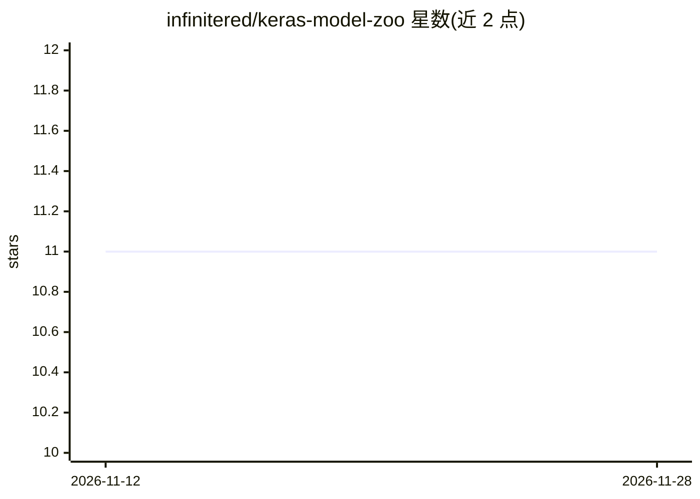

# infinitered/keras-model-zoo

⭐ 11 · MIT · 推送 2026-11-12 · [GitHub](https://github.com/infinitered/keras-model-zoo) · 组织维护

**面向 Keras 用户的可下载预训练模型库**

Keras 模型库清单页，收录可直接下载使用的 Keras 模型，表格列出模型名称与功能描述，如 Food 101 食物图像分类、猫狗人脸检测、MNIST 手写数字分类。由 Infinite Red 创建，采用社区贡献模式：贡献者提交 pull request 附模型链接，维护方将模型文件下载后托管到其 S3，贡献者同时在 /info 目录补充署名、示例等说明信息。

## 筛选速览

| 维度 | 判定 | 备注 |
|---|---|---|
| AI 角色 | `ai-knowledge` | 知识聚合/清单类 |
| 许可风险 | `permissive` | MIT |
| 部署形态 | `None` |  |
| 模型依赖 | — | README 未给出锁定关系 |
| 硬件要求 | — | 无带数字的原话,不猜 |
| 安装摩擦 | `low` | 无编译、无系统依赖或容器化 |
| 成熟度 | — | 结构信号不足 |

## 能力要点

- 提供可直接下载的 Keras 预训练模型（Food 101 / 猫狗脸 / MNIST 等）
- 社区可提交模型 PR，由维护方托管至 S3
- /info 目录收录模型署名与示例说明

## 适用场景

- 查找现成的图像分类/检测 Keras 模型直接下载使用
- 把自己训练的 Keras 模型提交入库获得托管

## 场景标签

 · 领域:机器学习/模型资源

## 证据(README 行号)

> L3: Ready to go, downloadable models for Keras
> L14: |Model|Description|

## 星数曲线

2026-11-12 11 → 2026-11-28 11（+0）

---
*卡片 v1 · prompt 1.4 · 生成 2026-11-18 · 置信度 high · 依据 README sha `7dc00993de3e` · [字段定义](../../DATASET.md)*
