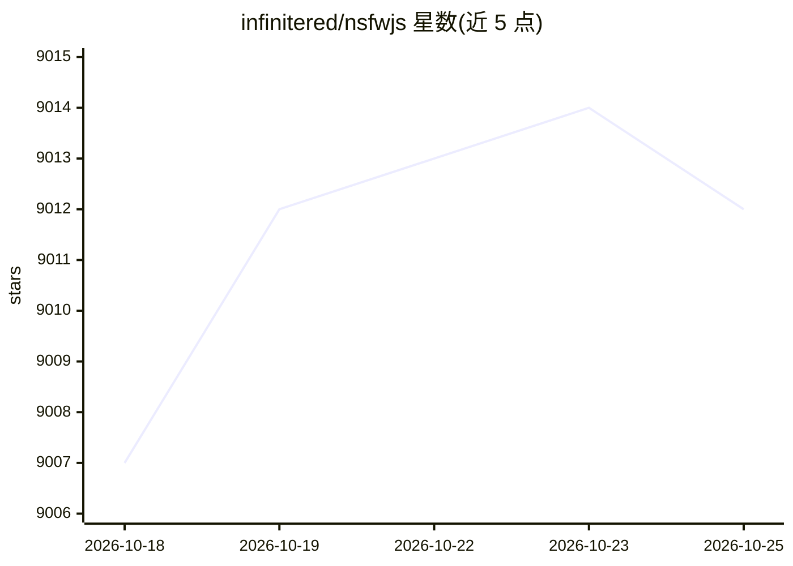

# infinitered/nsfwjs

⭐ 9,012 · TypeScript · MIT · 推送 2026-08-04 · [GitHub](https://github.com/infinitered/nsfwjs) · [官网](https://nsfwjs.com/) · 组织维护

**浏览器端不雅图像识别的 JavaScript 库（TensorFlow.js）**

基于 TensorFlow.js 的 NSFW 检测库，在客户端浏览器或 Node.js 服务器端对图像分类，输出 Drawing/Hentai/Neutral/Porn/Sexy 五类概率，README 标注准确率约 90%（小模型）~93%（中模型）。内置 MobileNetV2/MobileNetV2Mid/InceptionV3 三个模型，支持 tree-shaking 选择性打包、自托管模型文件、IndexedDB 缓存，后端可在 webgpu/webgl/wasm/cpu/tfjs-node 间选择。需以 @tensorflow/tfjs 为 peer dependency 一起安装。另提供网页 demo、React Native 与 Node.js 示例，及使用本库的 Chrome 扩展 NSFW Filter。

## 筛选速览

| 维度 | 判定 | 备注 |
|---|---|---|
| AI 角色 | `ai-native` | 本体是模型或模型工具 |
| 许可风险 | `permissive` | MIT |
| 部署形态 | `library` | 以包/库形式分发 |
| 模型依赖 | — | README 未给出锁定关系 |
| 硬件要求 | — | 无带数字的原话,不猜 |
| 安装摩擦 | `low` | 无编译、无系统依赖或容器化 |
| 成熟度 | — | 结构信号不足 |

## 能力要点

- 五分类图像概率输出，客户端浏览器内运行
- 内置 MobileNetV2 / MobileNetV2Mid / InceptionV3 三个模型
- 支持 nsfwjs/core tree-shaking 按需打包与自托管模型文件
- TensorFlow.js 后端可选：webgpu/webgl/wasm/cpu，Node.js 端用 tfjs-node

## 适用场景

- 在用户上传前于浏览器内检测不雅图片
- Node.js 服务端批量对图片做 NSFW 分类
- 为 Web 应用做内容过滤（如 NSFW Filter 扩展）

## 场景标签

`目标检测` · 领域:感知与多模态

## 证据(README 行号)

> L8: A simple JavaScript library to help you quickly identify unseemly images; all in the client's browser. NSFWJS isn't 
> L22: The library categorizes image probabilities in the following 5 classes:

## 星数曲线

2026-10-18 9,007 → 2026-10-25 9,012（+5）

---
*卡片 v1 · prompt 1.4 · 生成 2026-10-20 · 置信度 high · 依据 README sha `2ecd0ffa88c2` · [字段定义](../../DATASET.md)*
