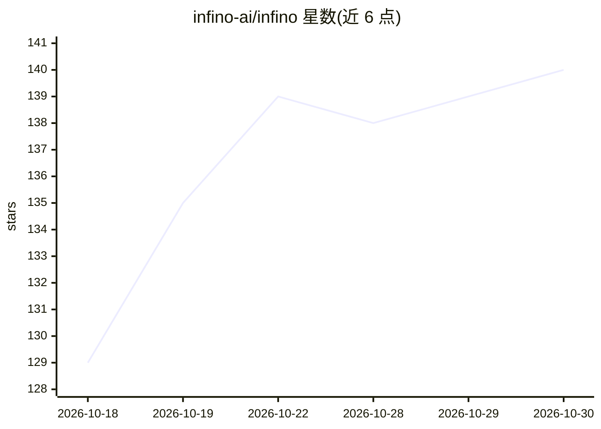

# infino-ai/infino

⭐ 140 · Rust · Apache-2.0 · 推送 2026-10-29 · [GitHub](https://github.com/infino-ai/infino) · [官网](http://infino.ai) · 组织维护

**嵌入式检索库：全文、向量、混合与 SQL 存于 Parquet 单表**

以 Rust 编写、通过 Python/Node/Rust 包分发的嵌入式检索库，在一张 Parquet 表上提供 BM25 全文检索、向量近似最近邻、混合检索与基于 Apache DataFusion 的 SQL 查询；数据以普通 Parquet 文件存于本地磁盘或对象存储（S3/gs://、Azure、memory://），无守护进程、无集群、无锁服务。机制包括：索引嵌入 Parquet 文件内、查询读字节区间、按查询选择最省的 BM25 算法、三段漏斗向量检索（1M 行 recall@10 0.992）、原子 manifest 提交与按目标召回率自调的 optimize()。限制：向量索引模式各有 RAM/规模取舍（hnsw_ivf 约 10M 行上限）。

## 筛选速览

| 维度 | 判定 | 备注 |
|---|---|---|
| AI 角色 | `ai-ecosystem` | LLM/agent 周边工具 |
| 许可风险 | `permissive` | Apache-2.0 |
| 部署形态 | `library` | 以包/库形式分发 |
| 模型依赖 | — | README 未给出锁定关系 |
| 硬件要求 | — | 无带数字的原话,不猜 |
| 安装摩擦 | `low` | 无编译、无系统依赖或容器化 |
| 成熟度 | — | 结构信号不足 |

## 能力要点

- BM25 与向量索引嵌入 Parquet 文件，DuckDB/pyarrow/DataFusion 可直接打开
- 支持本地路径、S3/gs://、Azure、memory:// 连接串，无守护进程
- 三种向量索引模式（ivf/flat_ivf/hnsw_ivf），optimize() 按目标召回率自校准
- WAND/MaxScore 等按查询挑选的 BM25 打分算法

## 适用场景

- 为应用嵌入全文+向量+SQL 一体的检索能力而无需单独数据库服务
- RAG 场景下用对象存储承载超出内存的检索表
- 用 DuckDB/pyarrow 直接读取带索引的 Parquet 数据

## 场景标签

`向量数据库` · 领域:知识与检索

## 证据(README 行号)

> L9: **Infino is a fast embedded retrieval library: full-text, vector, hybrid, and SQL over one table, stored as
> L169: Your app queries Infino, which caches in RAM and on disk over Parquet on object storage
> L317: SQL planning and execution is Apache DataFusion. Infino leverages the indexes it maintains for FTS

## 星数曲线

2026-10-18 129 → 2026-10-30 140（+11）

---
*卡片 v1 · prompt 1.4 · 生成 2026-10-22 · 置信度 high · 依据 README sha `6cd86dcf54b0` · [字段定义](../../DATASET.md)*
