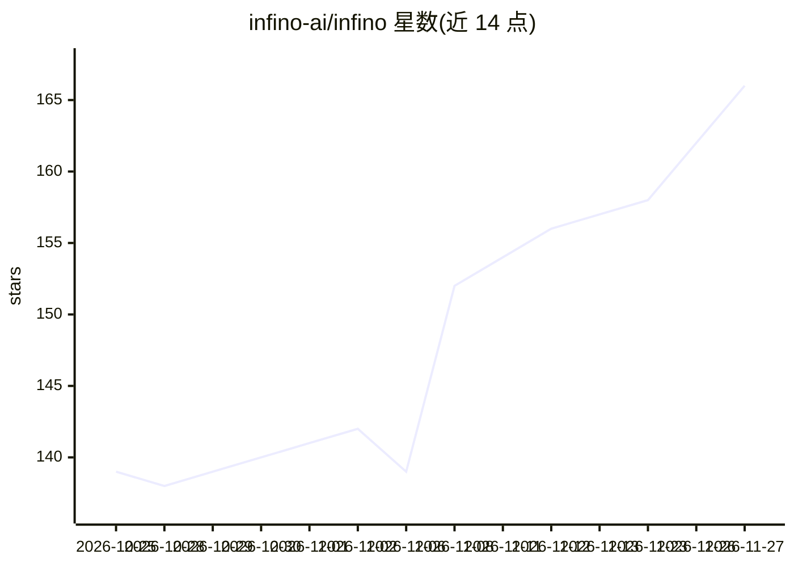

# infino-ai/infino

⭐ 166 · Rust · Apache-2.0 · 推送 2026-11-26 · [GitHub](https://github.com/infino-ai/infino) · [官网](http://infino.ai) · 组织维护

**嵌入 Parquet 的进程内搜索库：BM25、向量、混合与 SQL 查同一份数据**

以 Rust 编写、提供 Python 与 Node.js 绑定的进程内搜索库：将 BM25 与向量索引内嵌于 Parquet 文件，数据可存于本地磁盘或对象存储（S3/GCS/Azure），同一份文件可被 DuckDB、pyarrow、DataFusion 当作普通表读取并支持 SQL 查询。无需守护进程、集群或锁服务，写入为不可变文件加原子 manifest 交换，查询按字节范围从对象存储拉取并缓存。面向需要在应用内嵌全文/向量检索、做 RAG 或搜索服务的开发者。

## 筛选速览

| 维度 | 判定 | 备注 |
|---|---|---|
| AI 角色 | `ai-ecosystem` | LLM/agent 周边工具 |
| 许可风险 | `permissive` | Apache-2.0 |
| 部署形态 | `library` | 以包/库形式分发 |
| 模型依赖 | — | README 未给出锁定关系 |
| 硬件要求 | — | 无带数字的原话,不猜 |
| 安装摩擦 | `low` | 无编译、无系统依赖或容器化 |
| 成熟度 | — | 结构信号不足 |

## 能力要点

- BM25 与向量索引内嵌 Parquet 文件，同一文件支持 SQL 读取
- 支持本地磁盘与 S3/GCS/Azure 对象存储，查询按字节范围读取
- 提供 pip/npm/cargo 三语言安装（Python/Node.js/Rust）
- 可选 OpenSearch 插件，用 Infino 替换分片中的 Lucene

## 适用场景

- 为 RAG 应用提供进程内的混合检索（BM25+向量）
- 把搜索索引直接放在对象存储上，省去独立索引副本
- 在已有数据湖 Parquet 文件上直接跑全文与向量查询
- 在 OpenSearch 集群中替换 Lucene 存储引擎

## 场景标签

`RAG` `语义搜索` `向量数据库` · 领域:知识与检索

## 证据(README 行号)

> L9: **Infino is a search library built as an alternative to Lucene, and more: its full-text and vector indexes live
> L14: pip install infino              # Python
> L216:  (example).

## 星数曲线

2026-10-25 139 → 2026-11-27 166（+27）

---
*卡片 v1 · prompt 1.4 · 生成 2026-11-27 · 置信度 high · 依据 README sha `e0d932f9930c` · [字段定义](../../DATASET.md)*
