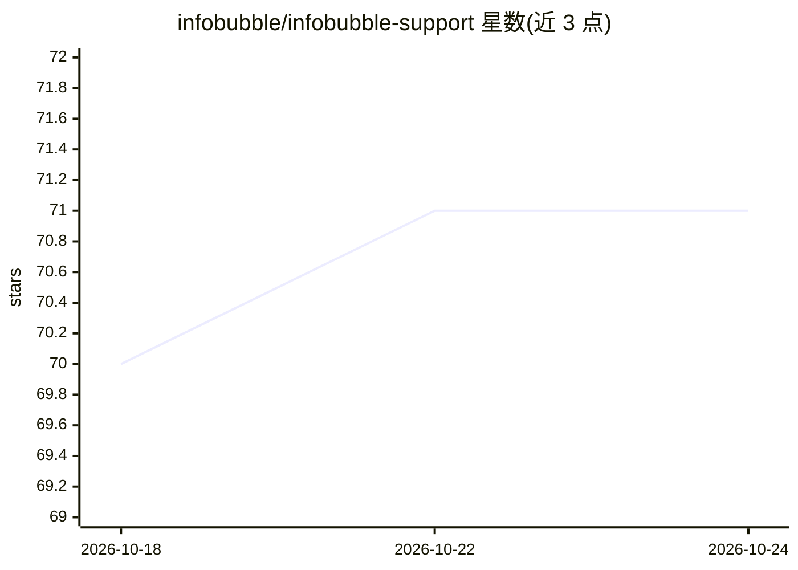

# infobubble/infobubble-support

⭐ 71 · 推送 2026-10-15 · [GitHub](https://github.com/infobubble/infobubble-support) · [官网](https://infobubble.github.io/infobubble-support/) · 个人维护

**macOS 新闻阅读器 InfoBubble 的支持页与 RSS 源目录**

InfoBubble 是 macOS 上的 RSS/网站新闻聚合应用（App Store 分发，macOS 26.0+），在本地分析文章的语气、主题与地点，支持阅读、搜索、摘要、对话与自定义 AI prompt 过滤，可选接入本地 AI（LM Studio）。本仓库为其支持仓库，收录文档手册与内置新闻网站/播客源目录（YAML 可下载），手册由 python3 脚本生成。免费版限 100 个源、3 个标签页与 2 个工作区，完整版为一次性应用内购买。

## 筛选速览

| 维度 | 判定 | 备注 |
|---|---|---|
| AI 角色 | `ai-enhanced` | 去掉 AI 部分产品仍成立 |
| 许可风险 | `none` | — |
| 部署形态 | `None` |  |
| 模型依赖 | — | README 未给出锁定关系 |
| 硬件要求 | — | 无带数字的原话,不猜 |
| 安装摩擦 | `low` | 无编译、无系统依赖或容器化 |
| 成熟度 | — | 结构信号不足 |

## 能力要点

- 在本地对文章做语气/主题/地点分析
- 支持 AI、机器学习、启发式三种处理模式
- 可接入本地 AI（LM Studio）
- 内置新闻源目录以 YAML 提供，可下载浏览

## 适用场景

- 我在 Mac 上聚合 RSS 和网站新闻并用 AI 过滤阅读
- 我想用本地模型离线分析新闻
- 查找可订阅的新闻网站与播客源清单

## 场景标签

`精选清单` · 领域:学习与行业

## 证据(README 行号)

> L2: ## News reader and AI filter for macOS, with a built-in database of news websites and podcasts
> L7: This is the support repository of InfoBubble, a partially free macOS app that collects news from RSS feeds

## 星数曲线

2026-10-18 70 → 2026-10-24 71（+1）

---
*卡片 v1 · prompt 1.4 · 生成 2026-10-24 · 置信度 mid · 依据 README sha `5f36aeb7fafa` · [字段定义](../../DATASET.md)*
