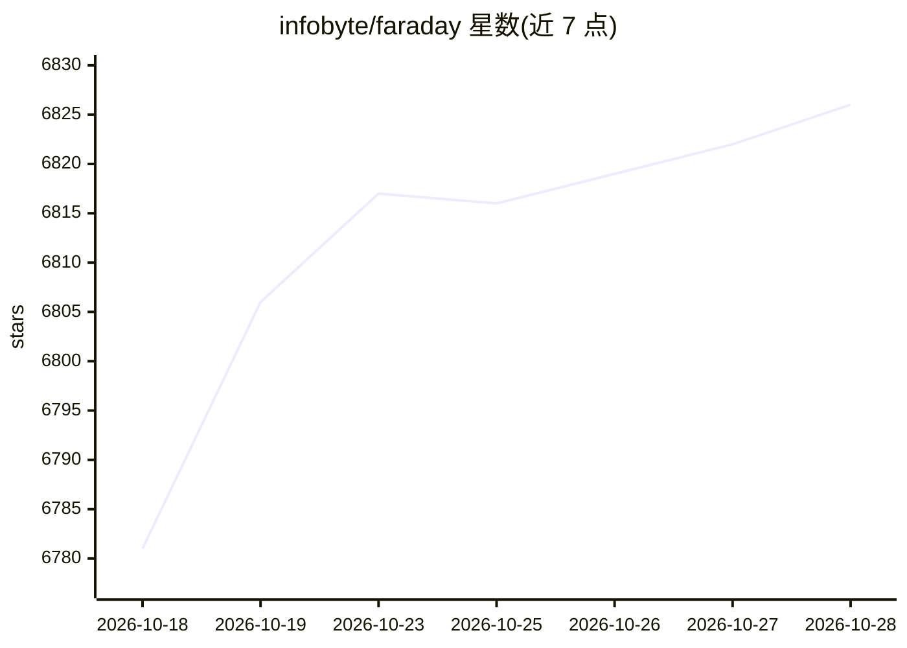

# infobyte/faraday

⭐ 6,826 · Python · GPL-3.0 · 推送 2026-10-26 · [GitHub](https://github.com/infobyte/faraday) · [官网](https://www.faradaysec.com) · 组织维护

**开源漏洞管理平台：聚合安全扫描结果并集中管理**

面向安全团队与分析师的漏洞管理平台：通过 80+ 插件接入 nmap、Burp、OWASP ZAP 等扫描工具，将加载的数据聚合与规范化，在多用户 Web 界面中提供看板等可视化，供分析师与管理者使用。支持通过 Faraday Agents Dispatcher 远程运行扫描器并回传结果，提供 CLI（faraday-cli）、REST API、CI/CD 集成示例与自定义插件机制。安装途径覆盖 docker-compose、pip（faradaysec）、Debian/RPM 包与源码运行，Docker 方式需自行准备 Postgres。仓库描述声明其为 AI 驱动的攻击性安全与自动化渗透测试工具，但可见 README 未展示 AI 功能细节。

## 筛选速览

| 维度 | 判定 | 备注 |
|---|---|---|
| AI 角色 | `ai-enhanced` | 去掉 AI 部分产品仍成立 |
| 许可风险 | `viral` | GPL-3.0 |
| 部署形态 | `desktop` | 安装包/桌面程序 |
| 模型依赖 | — | README 未给出锁定关系 |
| 硬件要求 | — | 无带数字的原话,不猜 |
| 安装摩擦 | `low` | 无编译、无系统依赖或容器化 |
| 成熟度 | — | 结构信号不足 |

## 能力要点

- 80+ 工具插件支持，分 Console（解析命令输出）与 Report（导入 XML/JSON 报告）两类
- faraday-cli 命令行客户端支持终端操作与 CI/CD 集成
- Agents Dispatcher 可远程运行扫描器并回传结果
- 提供 REST API 与多用户 Web 界面（localhost:5985）

## 适用场景

- 安全团队集中管理多来源漏洞数据并跟踪修复
- 在 CI/CD 流水线中自动运行扫描并汇总结果
- 通过插件机制接入常用安全工具的输出

## 场景标签

`网络安全` · 领域:学习与行业

## 证据(README 行号)

> L3: ### Open Source Vulnerability Manager
> L8: Faraday aggregates and normalizes the data you load, allowing exploring it into different visualizations that are us
> L112: Connect you favorite tools through our plugins. Right now there are more than 80+ supported tools, among which you

## 星数曲线

2026-10-18 6,781 → 2026-10-28 6,826（+45）

---
*卡片 v1 · prompt 1.4 · 生成 2026-10-20 · 置信度 mid · 依据 README sha `9c73f9c518c4` · [字段定义](../../DATASET.md)*
