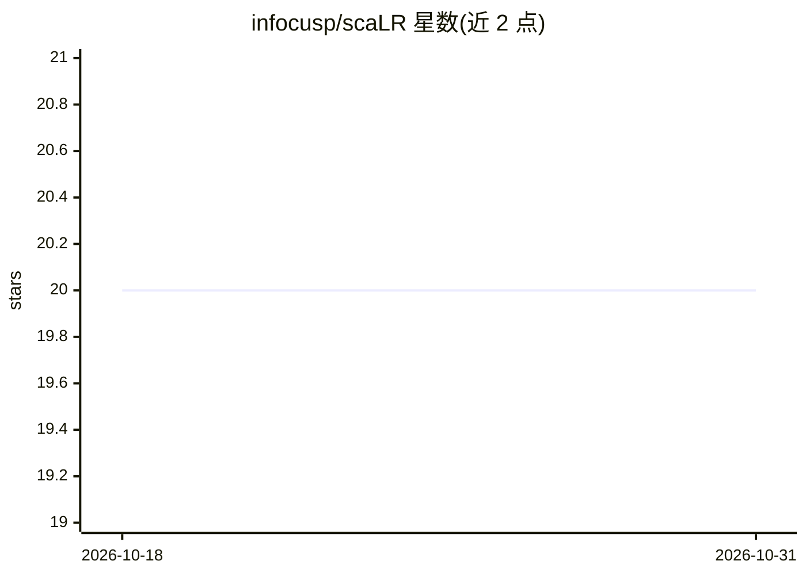

# infocusp/scaLR

⭐ 20 · Python · GPL-3.0 · 推送 2026-10-13 · [GitHub](https://github.com/infocusp/scaLR) · [官网](https://infocusp.github.io/scaLR/) · 组织维护

**低资源单细胞 RNA-seq 分析与生物标志物发现端到端流程**

面向 scRNA-seq 数据的端到端深度学习流程：数据预处理与归一化、基于模型系数/SHAP 的批量式特征选择、DNN 训练（含早停与批次效应校正）、测试集评估与下游分析（分类报告、ROC、基因排序热图、基因召回曲线、Pseudobulk/LMEM 两类 DGE 分析）。输入仅支持 anndata .h5ad 格式，经 config.yaml 配置后由 pipeline.py 运行，支持 cuda/cpu 设备切换；提供 pip 包、Colab 交互教程与本地 notebook 示例。已发表论文于 Briefings in Bioinformatics。

## 筛选速览

| 维度 | 判定 | 备注 |
|---|---|---|
| AI 角色 | `ai-native` | 本体是模型或模型工具 |
| 许可风险 | `viral` | GPL-3.0 |
| 部署形态 | `library` | 以包/库形式分发 |
| 模型依赖 | — | README 未给出锁定关系 |
| 硬件要求 | — | 无带数字的原话,不猜 |
| 安装摩擦 | `medium` | 含编译或系统依赖之一 |
| 成熟度 | — | 结构信号不足 |

## 能力要点

- 批量式特征选择，基于模型权重/SHAP 评分选取 top-k 特征
- DNN 训练含早停与训练期批次效应校正
- 下游分析含分类报告、ROC、热图、基因召回曲线与两种 DGE 方法
- 支持 cuda/cpu 设备，低资源环境下可运行

## 适用场景

- 对单细胞数据做细胞类型分类
- 识别临床条件相关的生物标志物基因
- 进行差异基因表达与基因召回分析

## 场景标签

 · 领域:生物信息学/单细胞组学

## 证据(README 行号)

> L16: 2. Features Extraction : A model is trained on feature subsets in a batch-wise process, so all features and samples
> L18: 3. Training : A Deep Neural Network (DNN) is trained on the training dataset. The validation dataset is used to val

## 星数曲线

2026-10-18 20 → 2026-10-31 20（+0）

---
*卡片 v1 · prompt 1.4 · 生成 2026-10-28 · 置信度 high · 依据 README sha `216a7294df46` · [字段定义](../../DATASET.md)*
