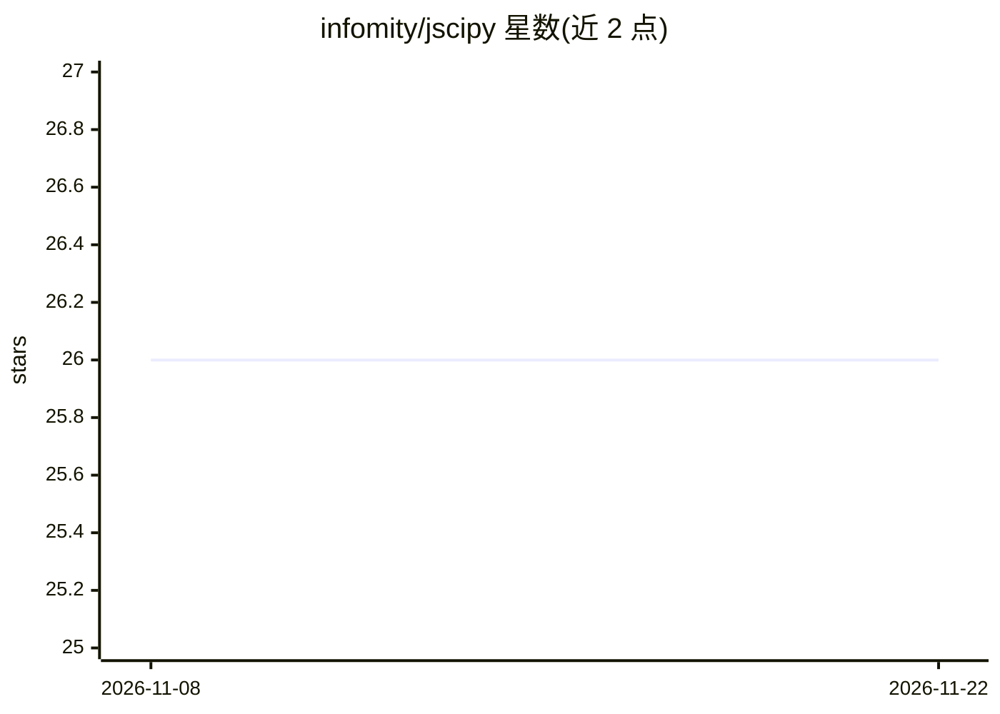

# infomity/jscipy

⭐ 26 · Java · MIT · 推送 2026-11-06 · [GitHub](https://github.com/infomity/jscipy) · [官网](https://infomity.github.io/jscipy/) · 个人维护

**面向 JVM 与 Android 的 Java 科学计算/信号处理库**

受 Python SciPy 启发的 Java 科学计算与信号处理库，供在 JVM 与 Android 上构建机器学习或信号处理管线的开发者使用。模块覆盖滤波器（Butterworth/Chebyshev/Elliptic/Bessel/FIR）、FFT/DCT/STFT/Hilbert 变换、Welch PSD、峰值检测、波形生成、插值（线性/三次样条/B-Spline）、RK4 ODE 求解器等。通过 Maven Central 或 JitPack 以 Gradle 依赖引入，声明无需前置依赖；以 SciPy 为 Golden Master 做精度测试。附 Android 示例应用。MIT 许可。

## 筛选速览

| 维度 | 判定 | 备注 |
|---|---|---|
| AI 角色 | `ai-ecosystem` | LLM/agent 周边工具 |
| 许可风险 | `permissive` | MIT |
| 部署形态 | `None` |  |
| 模型依赖 | — | README 未给出锁定关系 |
| 硬件要求 | — | 无带数字的原话,不猜 |
| 安装摩擦 | `low` | 无编译、无系统依赖或容器化 |
| 成熟度 | — | 结构信号不足 |

## 能力要点

- 滤波器族（Butterworth/Chebyshev/Elliptic/Bessel/FIR）支持 filtfilt/lfilter/sosfilt
- FFT/DCT/STFT/Hilbert 变换与 Welch PSD/频谱图等频谱分析
- 插值（线性/二次/三次样条/B-Spline）与 RK4 ODE 求解器
- 以 Python SciPy 为 Golden Master 进行精度（RMSE）测试

## 适用场景

- 在 Android 应用中直接做信号处理而无需 Python 环境
- JVM 机器学习或数据科学管线中的 FFT、滤波与特征提取
- 将 SciPy 风格的数值计算迁移到 Java 项目

## 场景标签

 · 领域:科学计算/信号处理

## 证据(README 行号)

> L13: **jSciPy** is a comprehensive **Java Scientific Computing and Signal Processing Library** designed for **Machine Le
> L21: In modern machine learning workflows, most signal processing tasks rely on Python's SciPy utilities. However, there

## 星数曲线

2026-11-08 26 → 2026-11-22 26（+0）

---
*卡片 v1 · prompt 1.4 · 生成 2026-11-18 · 置信度 high · 依据 README sha `e4098dccf9c5` · [字段定义](../../DATASET.md)*
