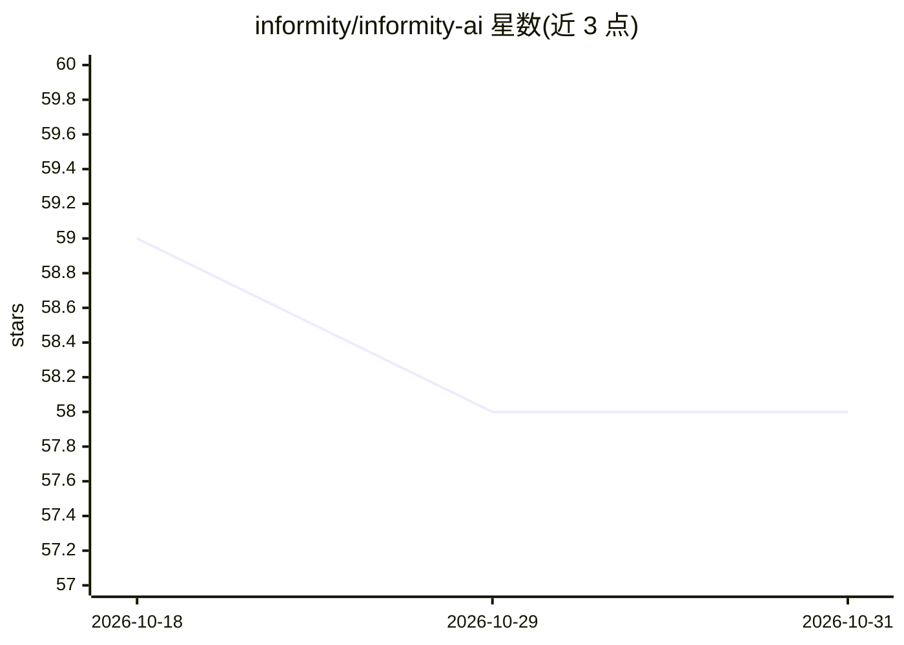

# informity/informity-ai

⭐ 58 · Python · MIT · 推送 2026-08-17 · [GitHub](https://github.com/informity/informity-ai) · [官网](https://www.informity.ai) · 组织维护

**macOS 本地文档问答应用：索引本机文件并用本地 RAG 回答**

面向 macOS 用户的隐私优先本地文档智能应用：扫描并索引本地文件，使用本地嵌入（nomic-embed-text-v1.5）与 SQLite/sqlite-vec 向量存储，经本地 RAG 流水线回答问题；LLM 推理默认走 xllamacpp（GGUF，默认 Qwen3.6 35B A3B Q4_K_M），可选 Ollama 运行时。PDF 用 Docling 处理（含 OCR），支持全隐私离线模式（安装后无网络请求）、聊天级临时上传、插件/集成双扩展机制，以及供 Claude Desktop 等外部 AI 客户端调用的只读 MCP 服务器。技术栈为 Python 3.13 + FastAPI + React，从源码运行（uv sync / make run）。

## 筛选速览

| 维度 | 判定 | 备注 |
|---|---|---|
| AI 角色 | `ai-native` | 本体是模型或模型工具 |
| 许可风险 | `permissive` | MIT |
| 部署形态 | `None` |  |
| 模型依赖 | local-ok | 支持本地模型 |
| 硬件要求 | — | 无带数字的原话,不猜 |
| 安装摩擦 | `medium` | 含编译或系统依赖之一 |
| 成熟度 | — | 结构信号不足 |

## 能力要点

- 本地 RAG：本地嵌入 + 本地 LLM 推理（xllamacpp/Metal），向量与文档留在本机
- Full Privacy Mode：安装后完全离线运行，不做任何网络请求
- Docling PDF 处理链（docling_full→docling_fast→pdf_text_layer）含 OCR 与策略回退
- 内置只读 MCP 服务器，供 Claude Desktop 等外部客户端查询索引库
- 可选 Ollama 运行时（映射 qwen3.6:35b 等模型 ID 到调优配置）

## 适用场景

- 在 macOS 上对本地文档做语义搜索与问答，数据不出本机
- 离线环境下的私有文档问答（安装后完全无网络）
- 通过 Claude Desktop 等 MCP 客户端查询已索引的个人文档库
- 针对单次会话上传的临时文件做研究式问答

## 场景标签

`文档问答` `语义搜索` · 领域:知识与检索

## 证据(README 行号)

> L12: Privacy-first local document intelligence for macOS.
> L13: Informity scans and indexes local files, then answers questions with a local RAG pipeline backed by local embedding
> L23: - Local LLM inference via `xllamacpp` (Metal/GPU on macOS)

## 星数曲线

2026-10-18 59 → 2026-10-31 58（-1）

---
*卡片 v1 · prompt 1.4 · 生成 2026-10-24 · 置信度 high · 依据 README sha `af6ea96a46ff` · [字段定义](../../DATASET.md)*
