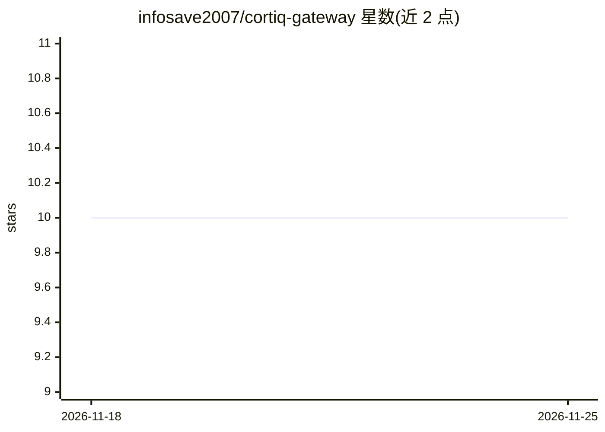

# infosave2007/cortiq-gateway

⭐ 10 · Rust · NOASSERTION · 推送 2026-08-21 · [GitHub](https://github.com/infosave2007/cortiq-gateway) · [官网](https://api.allaigate.com/) · 个人维护 · 中文 README

**面向开发者的统一 LLM 网关：一个端点自动路由多个模型**

用 Rust/Tokio 编写的 LLM 网关：对外暴露 OpenAI 兼容端点，客户端只需改 base_url 并指定 model 为 cortiq-auto，即由语义路由器按任务类型与复杂度在本地与云端模型池中选型，路由器不可用时降级到默认模型。支持 OpenAI Chat/Embeddings/Completions、Anthropic Messages 与 MCP 协议，内置 Web 管理控制台（7 种语言、热重载配置）、语义缓存、每请求成本与延迟统计及 Prometheus 指标端点。提供 Docker 镜像与单二进制文件（SPA 内嵌）。

## 筛选速览

| 维度 | 判定 | 备注 |
|---|---|---|
| AI 角色 | `ai-ecosystem` | LLM/agent 周边工具 |
| 许可风险 | `permissive` | NOASSERTION |
| 部署形态 | `self-host` | docker 或自建部署 |
| 模型依赖 | local-ok | 支持本地模型 |
| 硬件要求 | — | 无带数字的原话,不猜 |
| 安装摩擦 | `low` | 无编译、无系统依赖或容器化 |
| 成熟度 | — | 结构信号不足 |

## 能力要点

- OpenAI 兼容端点 + Anthropic/MCP 多协议接入，SSE 流式支持
- cortiq-auto 语义路由：按任务类型与复杂度分层选择模型池，带 fallback 与降级
- 内嵌 Web 管理控制台，配置热重载，无需手动编辑 TOML
- 语义缓存与每请求 token/成本/延迟统计，Prometheus /metrics 端点

## 适用场景

- 为 agent/SDK 提供统一网关，自动在便宜本地模型和昂贵云端模型间分配请求
- 团队部署网关统一管理 provider 密钥、限流与月度预算
- 通过控制台管理多 provider 密钥、路由层级与运行时统计

## 场景标签

`模型网关` · 领域:Agent 开发

## 证据(README 行号)

> L11: **A universal LLM gateway with intelligent routing.**
> L31: - **Multi-protocol.** OpenAI Chat & Embeddings, **Anthropic Messages** (in/out, streaming), and an **MCP** server (
> L150: `cortiq-auto` routing is powered by a **semantic router** — the classifier that reads a

## 星数曲线

2026-11-18 10 → 2026-11-25 10（+0）

---
*卡片 v1 · prompt 1.4 · 生成 2026-11-19 · 置信度 high · 依据 README sha `a1fd6def2825` · [字段定义](../../DATASET.md)*
