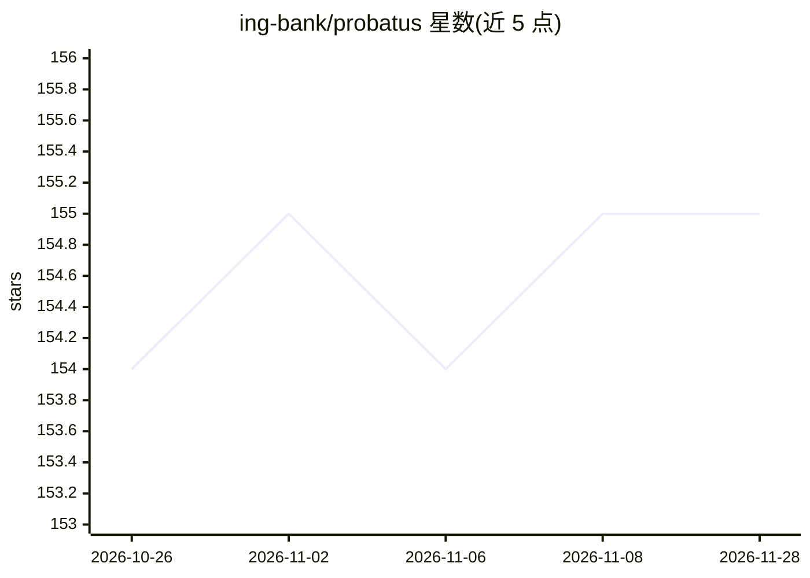

# ing-bank/probatus

⭐ 155 · Python · MIT · 推送 2026-11-05 · [GitHub](https://github.com/ing-bank/probatus) · [官网](https://ing-bank.github.io/probatus) · 组织维护

**为数据科学家提供基于 SHAP 的模型验证与特征选择工具**

Probatus 是一个 Python 包，用于验证回归与（多类）分类模型及其开发所用数据。三大模块：interpret 提供基于 SHAP 的模型解释工具；sample_similarity 通过相似性建模比较两个数据集（如训练集与时间外测试集）；feature_elimination.ShapRFECV 提供基于 SHAP 特征重要性的交叉验证递归特征消除。支持 Python 3.10–3.14，经 pip 安装，文档托管于 ing-bank.github.io。

## 筛选速览

| 维度 | 判定 | 备注 |
|---|---|---|
| AI 角色 | `ai-native` | 本体是模型或模型工具 |
| 许可风险 | `permissive` | MIT |
| 部署形态 | `library` | 以包/库形式分发 |
| 模型依赖 | — | README 未给出锁定关系 |
| 硬件要求 | — | 无带数字的原话,不猜 |
| 安装摩擦 | `low` | 无编译、无系统依赖或容器化 |
| 成熟度 | — | 结构信号不足 |

## 能力要点

- 基于 SHAP 的模型解释工具（probatus.interpret）
- ShapRFECV：交叉验证的递归特征消除
- 数据集相似性建模比较（train 与 out-of-time test）
- 支持二分类、多分类与回归问题

## 适用场景

- 对树模型或线性模型做 SHAP 解释
- 时间外测试前评估训练集与测试集的相似性
- 交叉验证框架下递归消除特征

## 场景标签

 · 领域:数据科学/机器学习工具

## 证据(README 行号)

> L11: **Probatus** is a python package that helps validate regression & (multiclass) classification models and the data u
> L13: - probatus.interpret provides shap-based model interpretation tools

## 星数曲线

2026-10-26 154 → 2026-11-28 155（+1）

---
*卡片 v1 · prompt 1.4 · 生成 2026-11-27 · 置信度 high · 依据 README sha `ddd94b83ce43` · [字段定义](../../DATASET.md)*
