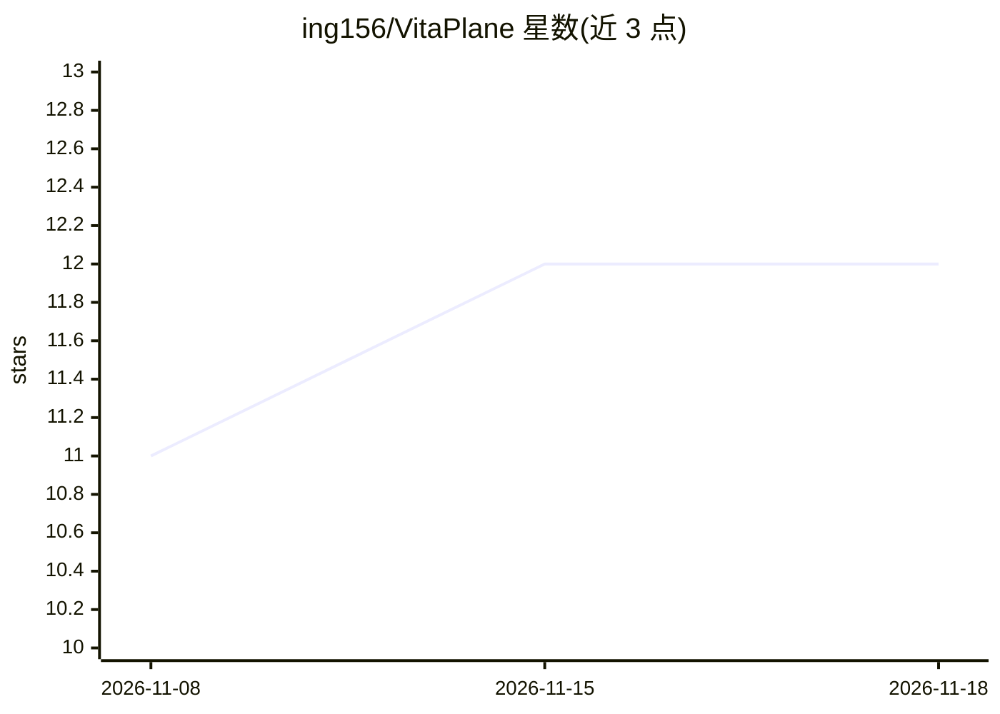

# ing156/VitaPlane

⭐ 12 · C++ · MIT · 推送 2026-11-04 · [GitHub](https://github.com/ing156/VitaPlane) · [官网](https://ing156.github.io/VitaPlane/) · 个人维护

**PS Vita 掌机上的第三方 Telegram 客户端**

运行于已破解（homebrew）PS Vita 的非官方 Telegram 客户端，支持读取聊天、收发消息与文件、使用贴纸、播放媒体、录制语音消息和视频圆圈，可通过按键或触屏操作。以 VPK 安装包分发，通过 VitaShell 安装后登录 Telegram 即可使用。项目基于 VitaSDK、vita2d 和 TDLib 开发，处于活跃开发阶段；README 声明 AI 工具辅助开发、文档与图像本地化，但方向与发布由人决定。源代码采用 MIT 许可，第三方资源保留各自许可。

## 筛选速览

| 维度 | 判定 | 备注 |
|---|---|---|
| AI 角色 | `ai-enhanced` | 去掉 AI 部分产品仍成立 |
| 许可风险 | `permissive` | MIT |
| 部署形态 | `None` |  |
| 模型依赖 | — | README 未给出锁定关系 |
| 硬件要求 | — | 无带数字的原话,不猜 |
| 安装摩擦 | `low` | 无编译、无系统依赖或容器化 |
| 成熟度 | `idea` | |

## 能力要点

- 支持收发消息、文件、贴纸、语音消息与视频圆圈
- 按键与触屏双操作方式
- 基于 VitaSDK、vita2d 与 TDLib 构建，以 VPK 包分发
- README 声明 AI 工具仅辅助开发、文档与图像本地化

## 适用场景

- 在 PS Vita 掌机上收发 Telegram 消息
- 通过掌机触屏查看聊天媒体与贴纸

## 场景标签

 · 领域:通信/掌机应用

## 证据(README 行号)

> L24: VitaPlane is under active development using VitaSDK, vita2d and TDLib. AI tools assist development, documentation a
> L12: Install the VPK through VitaShell on a homebrew-enabled PS Vita, then sign in to Telegram.

## 星数曲线

2026-11-08 11 → 2026-11-18 12（+1）

---
*卡片 v1 · prompt 1.4 · 生成 2026-11-18 · 置信度 high · 依据 README sha `b4fb2bc60b0e` · [字段定义](../../DATASET.md)*
