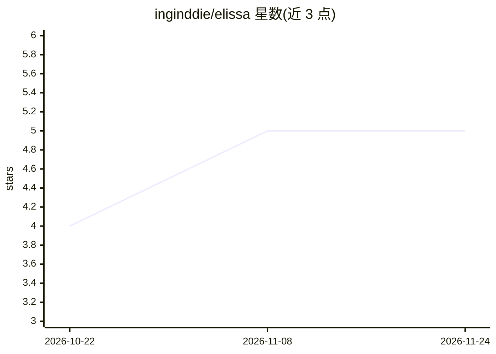

# inginddie/elissa

⭐ 5 · Python · MIT · 推送 2026-11-22 · [GitHub](https://github.com/inginddie/elissa) · 个人维护

**给 Windows 等桌面用户一个带虚拟形象、可确认操作的语音 AI 助手**

以 Tauri 2（Rust 外壳）加 Python 引擎架构运行的桌面语音助手：唤醒词离线检测、语音输入与朗读回答、14 种代码绘制表情的桌面角色。功能覆盖文件读写（PDF/Word/Excel/CSV）、控制应用与键鼠输入、提醒/计时、多协议邮件、代码协作、Spotify 音乐控制与 MCP 集成。关键机制：所有更改性操作（写文件、发邮件、执行命令）须在审批卡片上真实点击 Approve 才执行，部分危险操作直接拒绝。Windows 提供安装包，macOS/Linux 为 preview。MIT 许可。

## 筛选速览

| 维度 | 判定 | 备注 |
|---|---|---|
| AI 角色 | `ai-native` | 本体是模型或模型工具 |
| 许可风险 | `permissive` | MIT |
| 部署形态 | `desktop` | 安装包/桌面程序 |
| 模型依赖 | local-ok | 支持本地模型 |
| 硬件要求 | — | 无带数字的原话,不猜 |
| 安装摩擦 | `low` | 无编译、无系统依赖或容器化 |
| 成熟度 | — | 结构信号不足 |

## 能力要点

- 更改性操作须点击 Approve 卡片执行，语音与快捷键无法批准
- 支持 OpenAI/Claude/Gemini/OpenRouter/Groq 及本地 Ollama、LM Studio
- 唤醒词离线检测，休息态 CPU 占用低于 1%，麦克风仅监听时开启
- 无自有服务器、无遥测，API 密钥存于系统钥匙串

## 适用场景

- 免手动操作电脑：语音提问并朗读回答，处理提醒与计时
- 让助手读写文件、发邮件、跑测试改 bug，每步先审批
- 搭配本地 Ollama 实现数据不出本机的语音助手
- 接收 Claude Code / Codex 会话完成或待授权的通知

## 场景标签

`AI 助手` `语音 Agent` · 领域:对话与助手

## 证据(README 行号)

> L5: **A voice assistant with a face, living on your desktop.**
> L30: |🧠 **Any AI**|OpenAI, Claude, Gemini, OpenRouter, Groq, or free and local with Ollama or LM Studio.|
> L118:  Architecture: the Tauri 2 shell (Rust) with the transparent window, tray, global shortcut, autostart and signed u

## 星数曲线

2026-10-22 4 → 2026-11-24 5（+1）

---
*卡片 v1 · prompt 1.4 · 生成 2026-11-21 · 置信度 mid · 依据 README sha `bc1ed75eeb07` · [字段定义](../../DATASET.md)*
