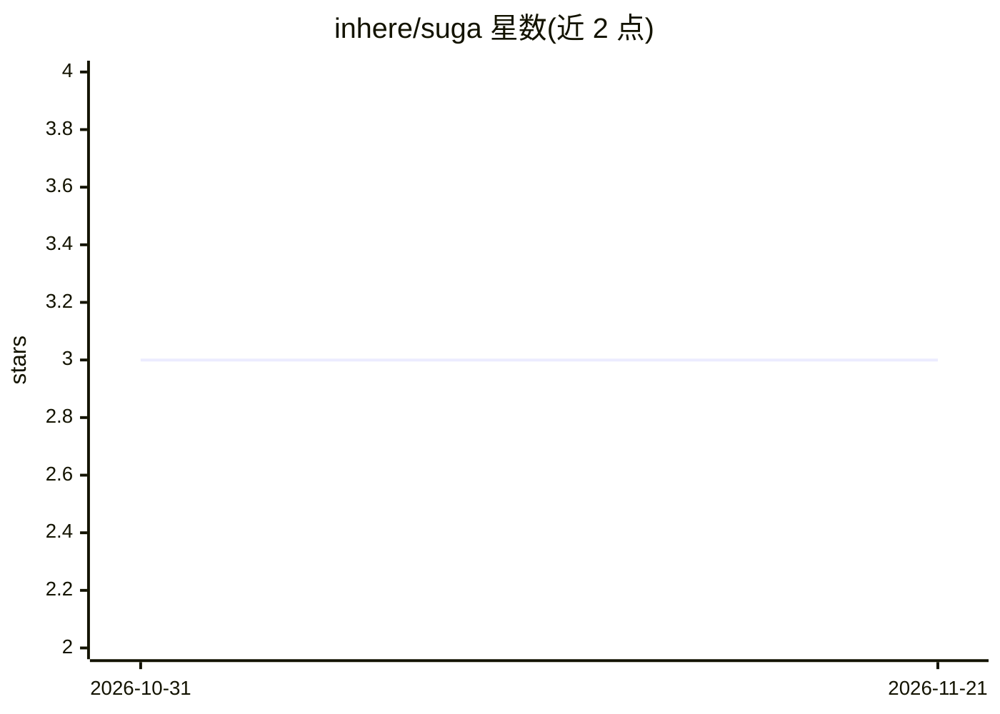

# inhere/suga

⭐ — · [GitHub]() · 个人维护 · 中文 README

**Go 编写的个人编码 agent：CLI+ACP 双接口持久会话引擎**

用 Go 实现的本地优先编码 agent，单一持久会话引擎提供终端 CLI（chat 与一次性 run）和 ACP stdio 服务端两种接口。工具能力包括按行窗口读文件、grep/find、精确替换编辑、shell 命令与 web fetch；默认只读、写操作需审批、文件工具限制在工作区内、web fetch 拒绝私有网络。会话持久化于 SQLite，支持恢复、自动压缩、计划、交接与事件日志；另提供子代理、SKILL.md 技能、MCP stdio 服务端（带允许清单）、跨会话用户/项目记忆及全文历史检索。提供 --verify 交付检查、JSON Schema 输出契约与停止过早的 nudge 检查；可通过 pkg/sugasdk 嵌入。定位为单二进制本地工具，非托管 SaaS 或图形 IDE 替代品。

## 筛选速览

| 维度 | 判定 | 备注 |
|---|---|---|
| AI 角色 | `ai-ecosystem` | LLM/agent 周边工具 |
| 许可风险 | `permissive` | — |
| 部署形态 | `library` | 以包/库形式分发 |
| 模型依赖 | — | README 未给出锁定关系 |
| 硬件要求 | — | 无带数字的原话,不猜 |
| 安装摩擦 | `medium` | 含编译或系统依赖之一 |
| 成熟度 | `idea` | |

## 能力要点

- 一个持久会话引擎，CLI（chat/run）与 ACP stdio 服务端双接口
- 默认只读+写审批、私有网络拒绝的安全机制，SQLite 持久会话与自动压缩
- --verify 交付检查与 --output-schema JSON Schema 输出契约，失败回注修正轮
- SKILL.md 技能、MCP 允许清单、跨会话记忆与全文历史搜索

## 适用场景

- 在终端里对本地项目做读取、编辑、跑测试等编码工作
- 作为 ACP 服务端接入编辑器或其它客户端
- 需要可审计工具调用与持久会话的自动化任务
- 通过 SDK 嵌入自建的 agent 工具链

## 场景标签

`编码 Agent` · 领域:编码与开发

## 证据(README 行号)

> L10: Suga is a personal coding agent written in Go. One persistent conversation engine serves two interfaces: a terminal
> L32: Suga is deliberately a local-first, single-binary tool. It combines read-only-by-default operation and approvals wi

## 星数曲线

2026-10-31 3 → 2026-11-21 3（+0）

---
*卡片 v1 · prompt 1.4 · 生成 2026-11-21 · 置信度 high · 依据 README sha `a37a16a17283` · [字段定义](../../DATASET.md)*
