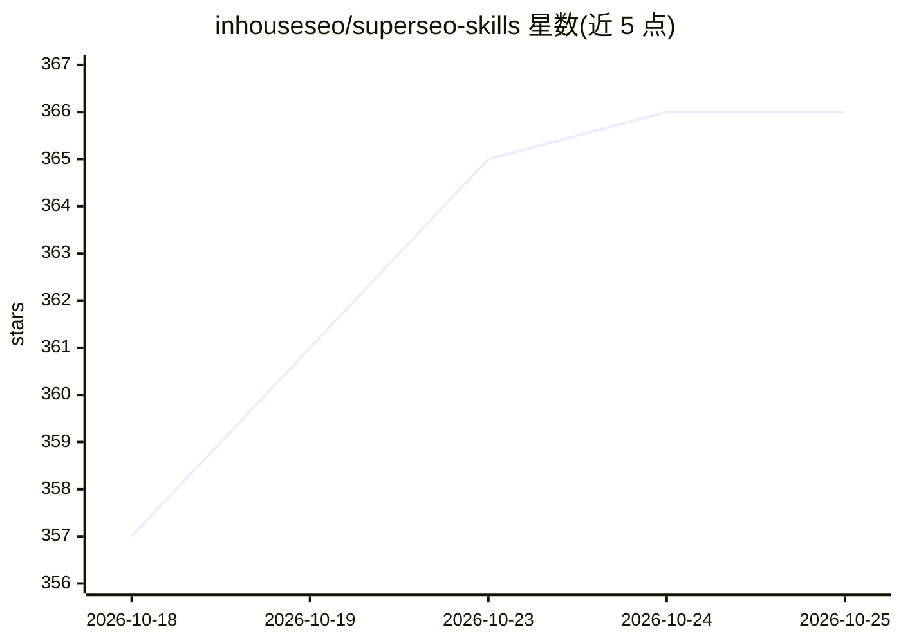

# inhouseseo/superseo-skills

⭐ 366 · Apache-2.0 · 推送 2026-09-03 · [GitHub](https://github.com/inhouseseo/superseo-skills) · [官网](https://inhouseseo.ai) · 组织维护

**给 SEO 从业者的 11 个 Claude 技能包：页面审计到文章生成**

面向 SEO 工作者的 Claude 技能集合：以 SKILL.md 形式提供 11 个技能（page-audit、content-brief、write-content、eeat-audit、linkbuilding、expert-interview 等），每技能单一输入（URL 或关键词），由 agent 自行抓取页面、检索并阅读竞品后产出审计、简报、文章或外链计划。每个技能捆绑 references 参考库（23 种内容类型模板、9 个外链战术手册、反 AI 套话写作规则）。无 API key、无数据导出；通过 Claude Code 插件市场、git clone 或上传安装，Cursor 与其他 agent 亦可使用。另有 9 个额外外链手册存于 InhouseSEO 平台（14 天试用）。仓库本身不含可执行代码。

## 筛选速览

| 维度 | 判定 | 备注 |
|---|---|---|
| AI 角色 | `ai-knowledge` | 知识聚合/清单类 |
| 许可风险 | `permissive` | Apache-2.0 |
| 部署形态 | `desktop` | 安装包/桌面程序 |
| 模型依赖 | locked-api |  |
| 硬件要求 | — | 无带数字的原话,不猜 |
| 安装摩擦 | `low` | 无编译、无系统依赖或容器化 |
| 成熟度 | — | 结构信号不足 |

## 能力要点

- 11 个技能均以单一输入（URL/关键词）触发 agent 自行研究
- 每技能捆绑 references 参考库：23 种内容类型模板、9 个外链战术手册
- 反 AI 套话写作规则集（分层禁用词表、结构模式检测、Horoscope Test）
- 兼容 Claude Code、Claude Desktop、Claude.ai、Cursor 及任意 agent（系统提示词粘贴）

## 适用场景

- 让 Claude agent 对指定 URL 自动完成带竞品研究的 SEO 页面审计
- 从关键词生成写作简报或完整 SEO 文章
- 按阶段执行外链建设战术并做 E-E-A-T 评估

## 场景标签

`提示工程` `AI 写作` · 领域:Agent 开发

## 证据(README 行号)

> L26: **11 skills in this repo:** `page-audit` · `content-brief` · `write-content` · `improve-content` · `keyword-deep-di
> L84: Each skill lives in its own folder at `skills/<skill-name>/SKILL.md` with a bundled `references/` subfolder for hea
> L157: This repository contains no executable code — the security surface is limited to the Markdown files a Claude agent

## 星数曲线

2026-10-18 357 → 2026-10-25 366（+9）

---
*卡片 v1 · prompt 1.4 · 生成 2026-10-22 · 置信度 high · 依据 README sha `9eeeb99fdd71` · [字段定义](../../DATASET.md)*
