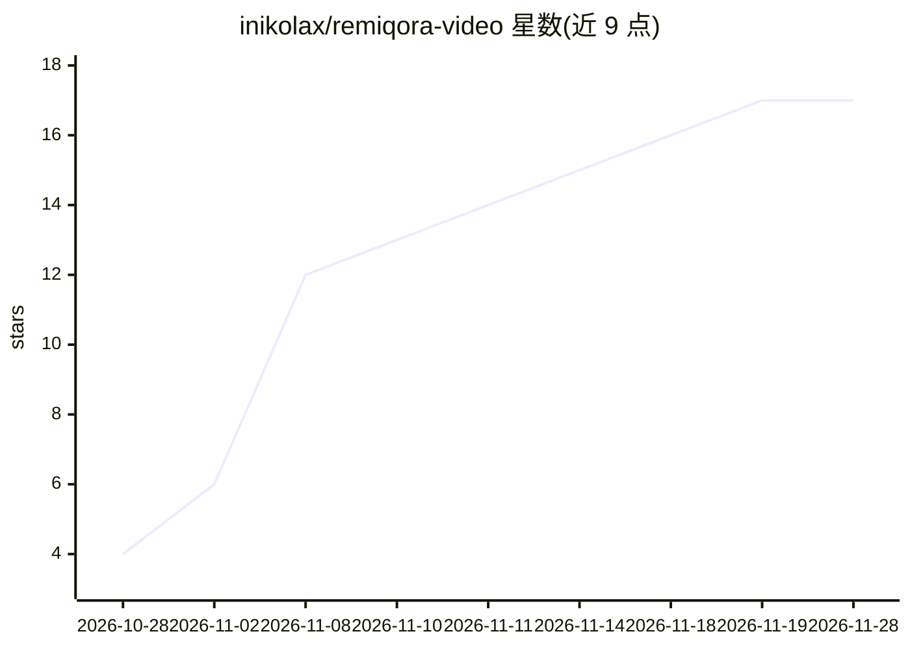

# inikolax/remiqora-video

⭐ 17 · Python · GPL-3.0 · 推送 2026-11-25 · [GitHub](https://github.com/inikolax/remiqora-video) · [官网](https://remiqora.com/video/) · 个人维护

**本地 GPU 视频工作室：一句话创意由本地 LLM 写分镜再逐场景生成影片**

面向 Windows + NVIDIA 的本地 AI 视频制作应用：用户用几句话描述创意，本地语言模型（经 llama.cpp 运行 GGUF）按所选视频模型的提示词格式拆写分镜，再由 MiniMax H3、LTX 2.5/2.3 或 WAN 2.2 逐场景生成带声音的镜头并自动成片，支持链式续接保持画面连贯、场景缓存、逐场景质量检查与自动重拍。内置剪辑时间线、节点图、音乐视频节拍剪辑，可输出 1080p/4K/HDR10 并导出 DaVinci Resolve（FCPXML）。模型权重从 Hugging Face 下载（H3 全套约 44 GB），LTX 需 gated 许可与 token。README 自述处于活跃开发期，非稳定版本。

## 筛选速览

| 维度 | 判定 | 备注 |
|---|---|---|
| AI 角色 | `ai-native` | 本体是模型或模型工具 |
| 许可风险 | `viral` | GPL-3.0 |
| 部署形态 | `desktop` | 安装包/桌面程序 |
| 模型依赖 | local-ok | 支持本地模型 |
| 硬件要求 | — | 无带数字的原话,不猜 |
| 安装摩擦 | `medium` | 含编译或系统依赖之一 |
| 成熟度 | `idea` | |

## 能力要点

- 本地 LLM 编剧 + MiniMax H3 / LTX / WAN 视频模型逐场景拍摄与自动成片
- ComfyUI 核心作为库内嵌于单一进程，无 ComfyUI 服务器与浏览器 UI
- 剪辑时间线、节点图（18 模板）与节拍对齐的音乐视频剪辑，导出 DaVinci Resolve FCPXML
- 场景级缓存与质量检查（黑帧/冻结/面部漂移），问题镜头换种子自动重拍一次

## 适用场景

- 把一句话创意直接变成带声音的数分钟短片或影片
- 制作跟随歌曲节拍剪辑的音乐视频
- 用节点图管理多版本、多结局的分镜分支并导出到 DaVinci Resolve 继续剪辑

## 场景标签

`视频生成` · 领域:内容生成

## 证据(README 行号)

> L8:  A local, GPU-powered video studio. You describe an idea in a couple of sentences, and a local language model writes
> L41: - **One worker for every model.** H3, LTX, WAN, Krea 2 and FLUX.2 Klein all run in one process: ComfyUI's core used
> L10:  🚧 Actively in development — expect breaking changes, bugs, and rough edges. Not a stable release yet.

## 星数曲线

2026-10-28 4 → 2026-11-28 17（+13）

---
*卡片 v1 · prompt 1.4 · 生成 2026-11-18 · 置信度 high · 依据 README sha `fdfae263d9e8` · [字段定义](../../DATASET.md)*
