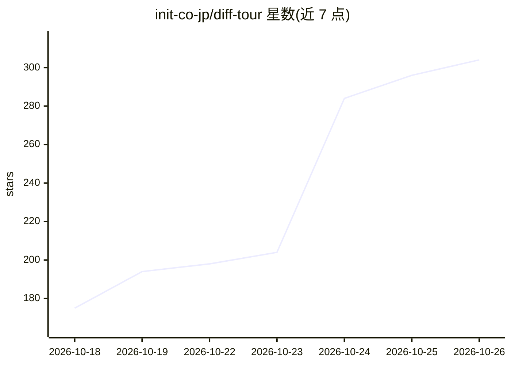

# init-co-jp/diff-tour

⭐ 304 · Go · MIT · 推送 2026-10-24 · [GitHub](https://github.com/init-co-jp/diff-tour) · 组织维护 · 中文 README

**把 git 变更转成 LLM 生成的讲解式导览 TUI，供阅读代码变更**

只读终端工具：对选定分支或提交，用 git archive/diff/log 导出前后两个版本的受控文件到缓存目录，随后以只读权限和固定提示词启动用户本机的 CLI agent（Claude Code、Codex CLI、Gemini CLI、OpenCode 2、Copilot CLI）生成一份 JSON 导览，校验其中文件与行号（最多回传修正两次），再用 ←/→ 两键分页展示：变更目的、评审关注点、必须修复项与可选项等。导览内容来自收集于 internal/generate/lessons 的评审经验。工具自身无网络请求、无遥测；LLM 仅能读导出目录，禁止写入、联网与加载 MCP。生成需 2-5 分钟，结果缓存可即时重开。

## 筛选速览

| 维度 | 判定 | 备注 |
|---|---|---|
| AI 角色 | `ai-native` | 本体是模型或模型工具 |
| 许可风险 | `permissive` | MIT |
| 部署形态 | `library` | 以包/库形式分发 |
| 模型依赖 | — | README 未给出锁定关系 |
| 硬件要求 | — | 无带数字的原话,不猜 |
| 安装摩擦 | `low` | 无编译、无系统依赖或容器化 |
| 成熟度 | `idea` | |

## 能力要点

- 用 git archive/diff/log 导出受控快照，LLM 以只读权限在缓存目录内生成导览
- 支持 Claude Code、Codex CLI、Gemini CLI、OpenCode 2、Copilot CLI 五种 CLI agent
- 导览 JSON 中的文件与行号会被校验，错误回传 LLM 修正（至多两次）
- 按各工具自身旗标（restricted/sandbox/admin-policy 等）强制只读、断网、禁 MCP，工具本身无网络请求与遥测

## 适用场景

- 新接手代码库时按资深工程师视角走读一个分支的变更
- 新人 onboarding：理解某次变更为什么这样写、评审者会担心什么
- code review 前快速了解变更的风险点与必须修复项

## 场景标签

`代码审查` · 领域:编码与开发

## 证据(README 行号)

> L43: `tour` turns a git change into a guided tour you step through with two keys, **→** and **←**. The tour shows what a
> L52: The tour is written by an LLM you already use: Claude Code, Codex CLI, Gemini CLI, OpenCode or Copilot CLI. `tour` 
> L64: 2. **Write.** `tour` starts the LLM's command-line tool in that directory with a fixed prompt and read-only permiss

## 星数曲线

2026-10-18 175 → 2026-10-26 304（+129）

---
*卡片 v1 · prompt 1.4 · 生成 2026-10-22 · 置信度 high · 依据 README sha `ca96d6760b22` · [字段定义](../../DATASET.md)*
