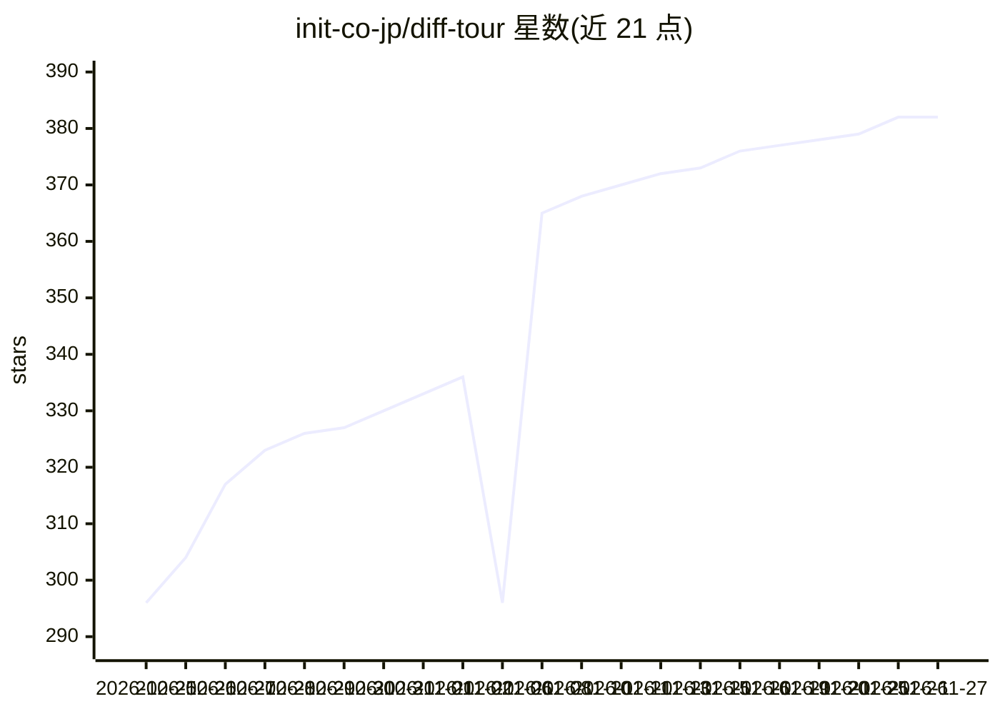

# init-co-jp/diff-tour

⭐ 382 · Go · MIT · 推送 2026-11-18 · [GitHub](https://github.com/init-co-jp/diff-tour) · 组织维护

**把 git diff 变成 LLM 生成的分步导览 TUI，供开发者学习**

diff-tour 是只读终端 TUI，调用用户已登录的 LLM 命令行工具（Claude Code、Codex CLI、Gemini CLI、OpenCode、Copilot CLI、Pi）读取 git 变更，生成带导航的分步导览：改动目的、审阅重点、思考题与答案。它通过向各工具传入严格参数（限只读工具、禁 MCP/网络/写入、会话不持久）控制 LLM 行为，tour 为 JSON 并校验文件行号引用，本工具自身不发起网络请求。需 git 和一个受支持的 LLM CLI；tour 生成需 2-5 分钟。

## 筛选速览

| 维度 | 判定 | 备注 |
|---|---|---|
| AI 角色 | `ai-native` | 本体是模型或模型工具 |
| 许可风险 | `permissive` | MIT |
| 部署形态 | `library` | 以包/库形式分发 |
| 模型依赖 | — | README 未给出锁定关系 |
| 硬件要求 | — | 无带数字的原话,不猜 |
| 安装摩擦 | `low` | 无编译、无系统依赖或容器化 |
| 成熟度 | `idea` | |

## 能力要点

- 只读 TUI：逐步浏览 LLM 生成的 diff 导览（→/←/q）
- 对每个 LLM CLI 传入只读限制参数并禁用 MCP、网络与会话持久化
- 校验导览 JSON 中的文件与行号引用，错误最多回传修正两次
- 本工具自身无服务器、无遥测，导览缓存后可秒开

## 适用场景

- 接入新代码库时按导览理解一次变更的设计意图
- 学习资深工程师审阅代码时的关注点与提问方式
- 在不改动工作区的前提下审阅分支或未提交变更

## 场景标签

`代码审查` · 领域:编码与开发

## 证据(README 行号)

> L51: `tour` turns a git change into a guided tour you step through with two keys, **→** and **←**. The tour shows what a
> L60: The tour is written by an LLM you already use: Claude Code, Codex CLI, Gemini CLI, OpenCode, Copilot CLI or Pi. `to
> L71: 1. **Export.** `tour` reads your repository with `git archive`, `git diff` and `git log`, and writes the files into

## 星数曲线

2026-10-25 296 → 2026-11-27 382（+86）

---
*卡片 v1 · prompt 1.4 · 生成 2026-11-25 · 置信度 high · 依据 README sha `27a8317e1f06` · [字段定义](../../DATASET.md)*
