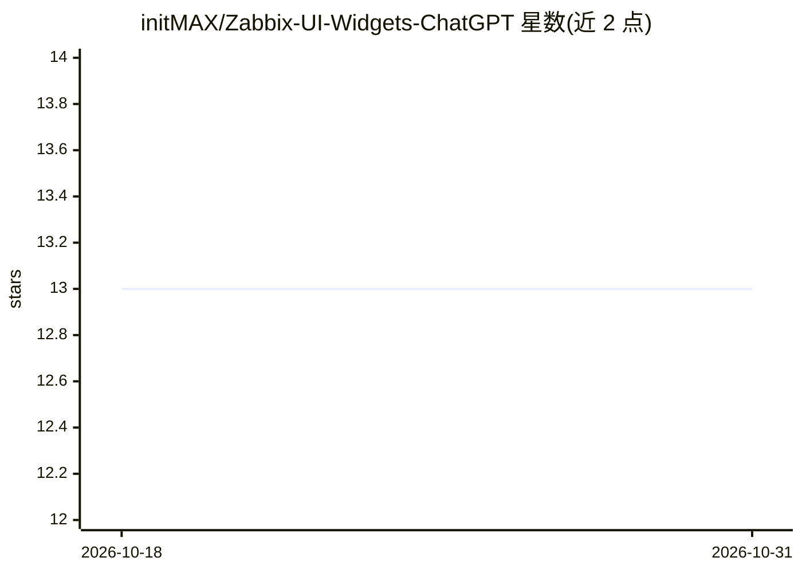

# initMAX/Zabbix-UI-Widgets-ChatGPT

⭐ 13 · NOASSERTION · 推送 2026-10-27 · [GitHub](https://github.com/initMAX/Zabbix-UI-Widgets-ChatGPT) · [官网](https://www.initmax.com/product/chatgpt/) · 组织维护

**Zabbix 仪表盘内的 AI 聊天小组件，接入多家模型答疑**

由 initMAX 维护的 Zabbix 仪表盘小组件：在监控面板内提供经服务器代理的 AI 对话，管理员统一配置 API token 并按团队/用户设置可见范围，密钥不经浏览器传输。FREE 版接入 OpenAI（AGPLv3）；PRO 版增加 Gemini/Claude/自定义 OpenAI 兼容端点（Ollama、vLLM）、按 token 调参、MCP 实时查询 Zabbix 数据、附件上传与组织级默认配置。以 GPG 签名的 deb/rpm 包或 ZIP 安装，要求 Zabbix 6.0-8.0 与 PHP 7.4+。

## 筛选速览

| 维度 | 判定 | 备注 |
|---|---|---|
| AI 角色 | `ai-native` | 本体是模型或模型工具 |
| 许可风险 | `none` | NOASSERTION |
| 部署形态 | `None` |  |
| 模型依赖 | local-ok | 支持本地模型 |
| 硬件要求 | — | 无带数字的原话,不猜 |
| 安装摩擦 | `low` | 无编译、无系统依赖或容器化 |
| 成熟度 | — | 结构信号不足 |

## 能力要点

- 服务器代理请求，API 密钥按可见范围管理且不进入浏览器
- FREE 支持流式 markdown 渲染回答与 27 种 Zabbix 显示语言
- PRO 支持 Gemini/Claude/自定义 OpenAI 兼容端点（Ollama、vLLM）
- PRO 可经 MCP 让模型查询实时 Zabbix 监控数据

## 适用场景

- 值班时在仪表盘旁直接询问触发器含义或排查方法
- 把已解决的事件整理成 runbook 初稿
- 管理员统一管控各团队的 AI API token 与模型选择

## 场景标签

`AI 助手` `聊天机器人` · 领域:对话与助手

## 证据(README 行号)

> L7:  An AI chat widget for Zabbix dashboards.
> L8: Ask about your infrastructure without leaving the board - a server-proxied chat with OpenAI, Gemini, Claude or your 
> L28: Troubleshooting means switching between the dashboard and a chat window - and pasting company context into a person

## 星数曲线

2026-10-18 13 → 2026-10-31 13（+0）

---
*卡片 v1 · prompt 1.4 · 生成 2026-10-31 · 置信度 high · 依据 README sha `8fd42aaab5eb` · [字段定义](../../DATASET.md)*
