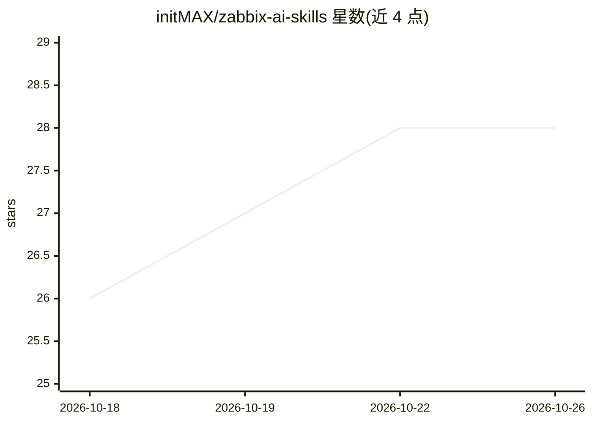

# initMAX/zabbix-ai-skills

⭐ 28 · AGPL-3.0 · 推送 2026-03-31 · [GitHub](https://github.com/initMAX/zabbix-ai-skills) · [官网](https://www.initmax.com) · 组织维护

**Zabbix 运维 AI 技能集：通过 MCP 自动执行监控管理任务**

由 initMAX 维护的 Zabbix AI 技能集合：每个技能是一个结构化 Markdown 提示词，指挥 AI 客户端通过 Zabbix MCP Server（提供 220 个 Zabbix API 工具）串联多次 API 调用完成实际运维任务。技能覆盖监控排障、问题关联分析、主机/用户添加向导、模板升级与 git 管理、配置审计/备份、容量预测等，以斜杠命令或粘贴提示词方式在 Claude Code、VS Code Copilot、ChatGPT、Cursor、JetBrains AI 等 MCP 兼容客户端中使用。依赖已安装并连接的 Zabbix MCP Server 及相应 API 权限。

## 筛选速览

| 维度 | 判定 | 备注 |
|---|---|---|
| AI 角色 | `ai-ecosystem` | LLM/agent 周边工具 |
| 许可风险 | `viral` | AGPL-3.0 |
| 部署形态 | `None` |  |
| 模型依赖 | — | README 未给出锁定关系 |
| 硬件要求 | — | 无带数字的原话,不猜 |
| 安装摩擦 | `low` | 无编译、无系统依赖或容器化 |
| 成熟度 | — | 结构信号不足 |

## 能力要点

- 技能为自包含 Markdown 提示词，编排多次 MCP 工具调用
- 覆盖监控、配置管理、模板升级、审计备份等 40+ 个技能
- 兼容任何支持 Zabbix MCP Server 的 AI 客户端
- 用户可用 YAML frontmatter 的 .md 文件自定义技能

## 适用场景

- 运维人员用一句话生成 Zabbix 状态总览或值班交接报告
- 自动检测异常指标、关联故障并定位根因
- 通过对话向导完成添加主机、创建维护窗口等配置操作

## 场景标签

`提示工程` · 领域:Agent 开发

## 证据(README 行号)

> L45: **Zabbix AI Skills** is a collection of ready-to-use AI workflows that automate common Zabbix operations. Each skil
> L140: Skills are structured Markdown prompts that orchestrate MCP tool calls. They work with any AI client that supports

## 星数曲线

2026-10-18 26 → 2026-10-26 28（+2）

---
*卡片 v1 · prompt 1.4 · 生成 2026-10-26 · 置信度 high · 依据 README sha `bd8f9148e565` · [字段定义](../../DATASET.md)*
