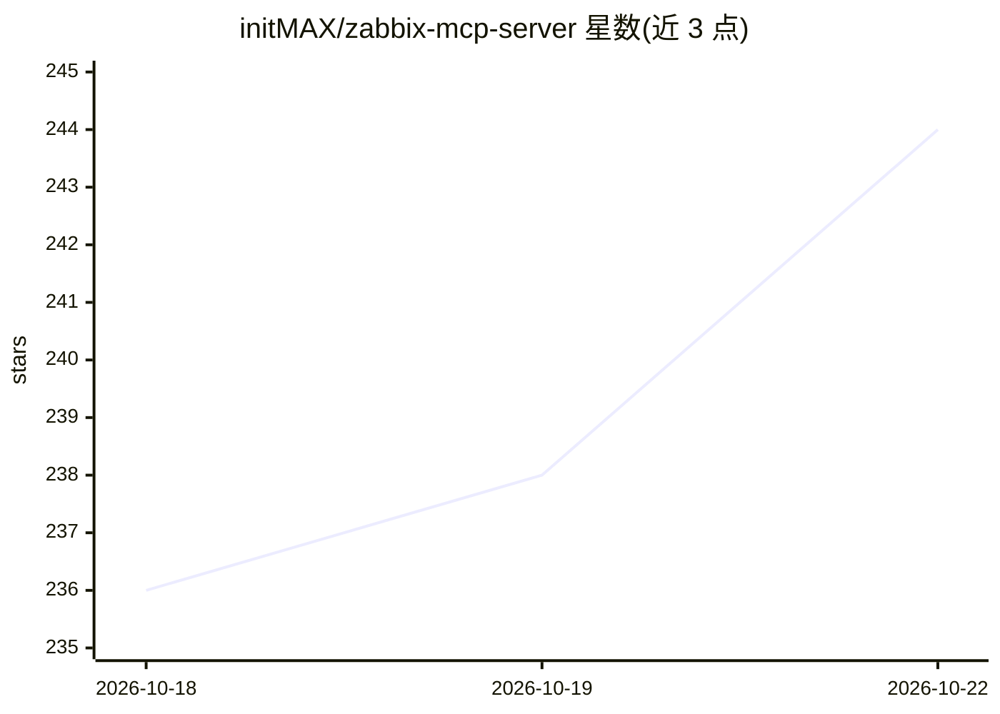

# initMAX/zabbix-mcp-server

⭐ 244 · Python · AGPL-3.0 · 推送 2026-10-20 · [GitHub](https://github.com/initMAX/zabbix-mcp-server) · [官网](https://www.initmax.com) · 组织维护

**将完整 Zabbix API 暴露给 MCP 客户端的服务器（241+14 工具）**

独立 HTTP 服务，把全部 68 个 Zabbix API 组封装为 241 个 MCP 工具，另加 14 个扩展工具（预关联视图、PNG 图表导出、PDF 报告、异常检测、容量预测、两步写审批等），供 Claude、Codex、VS Code、JetBrains 等 MCP 客户端查询主机、处理告警、管理模板。支持多 Zabbix 实例、多 token 鉴权（作用域/IP 限制/过期）、只读模式、限流与工具过滤以控制 LLM 上下文占用。提供 9090 端口管理门户、systemd/logrotate/Docker 部署脚本与无 root 的用户态安装；Zabbix 5.0/5.2 仅保留显式 legacy 密码登录路径且标记为安全风险。

## 筛选速览

| 维度 | 判定 | 备注 |
|---|---|---|
| AI 角色 | `ai-ecosystem` | LLM/agent 周边工具 |
| 许可风险 | `viral` | AGPL-3.0 |
| 部署形态 | `self-host` | docker 或自建部署 |
| 模型依赖 | — | README 未给出锁定关系 |
| 硬件要求 | — | 无带数字的原话,不猜 |
| 安装摩擦 | `low` | 无编译、无系统依赖或容器化 |
| 成熟度 | — | 结构信号不足 |

## 能力要点

- 全部 68 个 Zabbix API 组封装为 241 个 MCP 工具，另有 zabbix_raw_api_call 兜底
- 扩展工具：预关联视图、anomaly_detect、capacity_forecast、PDF 报告生成
- 多实例连接 + 多 token 鉴权（作用域、IP 限制、服务器绑定、过期）
- 工具过滤与紧凑输出模式，控制 LLM 上下文与响应 token 占用

## 适用场景

- 让 Claude/Codex/IDE 内的 AI 助手直接查询与操作 Zabbix 监控数据
- 运维通过对话查问题、确认告警、生成 PDF 巡检报告
- 生产环境以 systemd/Docker 部署并按最小权限管理多套 Zabbix 凭据

## 场景标签

 · 领域:运维监控/AI 工具接入

## 证据(README 行号)

> L23: **MCP** (Model Context Protocol) is an open standard that lets AI assistants (ChatGPT, Claude, VS Code Copilot, Jet
> L29: - **Complete API coverage** - All 68 Zabbix API groups (241 tools): hosts, problems, triggers, templates, users, da

## 星数曲线

2026-10-18 236 → 2026-10-22 244（+8）

---
*卡片 v1 · prompt 1.4 · 生成 2026-10-22 · 置信度 mid · 依据 README sha `b22cb54b3942` · [字段定义](../../DATASET.md)*
