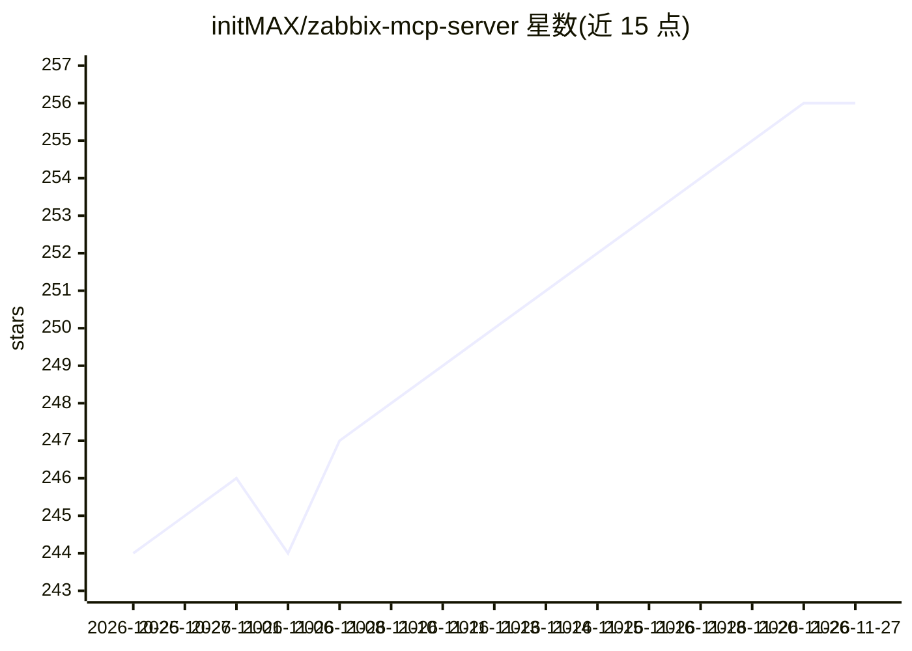

# initMAX/zabbix-mcp-server

⭐ 256 · Python · AGPL-3.0 · 推送 2026-11-13 · [GitHub](https://github.com/initMAX/zabbix-mcp-server) · [官网](https://www.initmax.com) · 组织维护

**把 Zabbix API 暴露为 237+ MCP 工具的服务器，供 AI 客户端查询与运维监控**

由 initMAX 维护的独立 HTTP 服务，将 Zabbix API 封装为 MCP 工具（覆盖 68 个 API 组、241 个工具），使兼容 MCP 的 AI 客户端能查询主机、问题、模板、确认事件等。提供多 Zabbix 实例连接、命名令牌鉴权与 IP 限制、按类别过滤工具、只读模式、限流与自动重连；附带管理 Web 门户（端口 9090）与客户端配置生成向导。部署通过 git clone 后运行安装脚本（systemd/Docker），要求 Linux + Python 3.10+ 与 Zabbix API token。

## 筛选速览

| 维度 | 判定 | 备注 |
|---|---|---|
| AI 角色 | `ai-ecosystem` | LLM/agent 周边工具 |
| 许可风险 | `viral` | AGPL-3.0 |
| 部署形态 | `self-host` | docker 或自建部署 |
| 模型依赖 | — | README 未给出锁定关系 |
| 硬件要求 | — | 无带数字的原话,不猜 |
| 安装摩擦 | `low` | 无编译、无系统依赖或容器化 |
| 成熟度 | — | 结构信号不足 |

## 能力要点

- 覆盖全部 68 个 Zabbix API 组（241 个工具）及 14 个扩展工具（PDF 报告、容量预测、两步写入确认等）
- 多服务器/多令牌支持，带作用域、IP 限制、只读模式与限流（300 次/分）
- 管理 Web 门户与面向 14 个 AI 客户端的 MCP 配置向导
- systemd 服务、logrotate、Docker 支持，v1.15+ 一条 update 命令完成升级

## 适用场景

- 让 Claude/ChatGPT/VS Code 等 AI 客户端直接查询 Zabbix 主机状态与告警
- 通过自然语言执行 Zabbix 模板与事件管理操作
- 运维团队以只读令牌安全接入生产 Zabbix 实例
- 生成监控基础设施汇总与 PDF 报告

## 场景标签

 · 领域:运维监控/AI 基础设施

## 证据(README 行号)

> L23: **MCP** (Model Context Protocol) is an open standard that lets AI assistants (ChatGPT, Claude, VS Code Copilot, Jet
> L25: The server runs as a standalone HTTP service. AI clients connect to it over the network.

## 星数曲线

2026-10-25 244 → 2026-11-27 256（+12）

---
*卡片 v1 · prompt 1.4 · 生成 2026-11-25 · 置信度 mid · 依据 README sha `76027a0833fd` · [字段定义](../../DATASET.md)*
