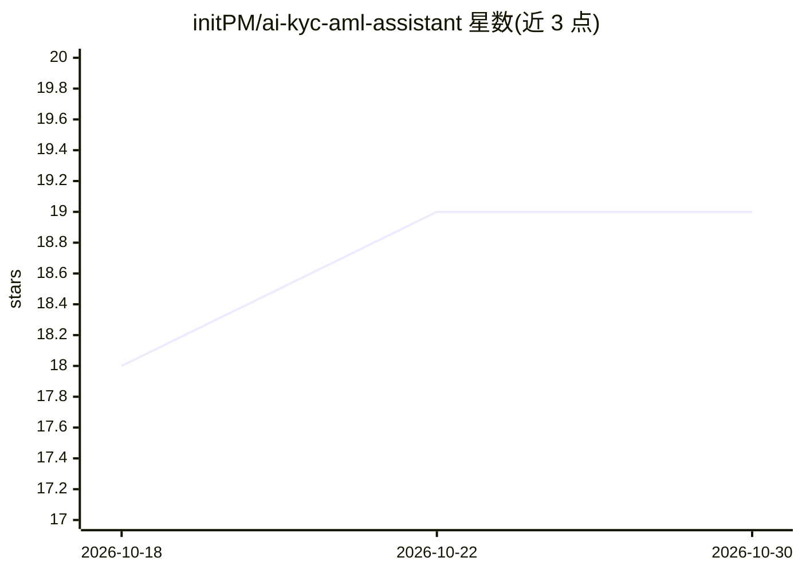

# initPM/ai-kyc-aml-assistant

⭐ 19 · TypeScript · MIT · 推送 2026-09-24 · [GitHub](https://github.com/initPM/ai-kyc-aml-assistant) · 个人维护

**AI 辅助的 KYC/AML 合规审查仪表盘原型**

面向合规团队的 FinTech 原型：处理客户入驻数据，模拟证件验证与制裁/PEP 名单筛查，按规则聚合风险评分并生成自然语言案例摘要，配有人工决策与审计日志的审查队列。当前 V1 为静态原型，使用内置合成 JSON 数据，未接入真实 LLM API 或验证服务商。前端采用 React/TypeScript/Vite/Tailwind，需 Node.js 18+ 以 npm 启动。

## 筛选速览

| 维度 | 判定 | 备注 |
|---|---|---|
| AI 角色 | `ai-enhanced` | 去掉 AI 部分产品仍成立 |
| 许可风险 | `permissive` | MIT |
| 部署形态 | `library` | 以包/库形式分发 |
| 模型依赖 | — | README 未给出锁定关系 |
| 硬件要求 | — | 无带数字的原话,不猜 |
| 安装摩擦 | `low` | 无编译、无系统依赖或容器化 |
| 成熟度 | `idea` | |

## 能力要点

- 风险评分驱动的案例优先级队列与自动路由
- LLM 概念的 AI 案例摘要与建议面板
- 透明规则初始标记，AI 仅用于摘要与特征提取
- 全流程审计日志设计（Human-in-the-Loop 决策）

## 适用场景

- 合规分析师借助 AI 摘要快速审阅 KYC 案例
- AML 经理查看案例审计轨迹与风险标记依据
- 演示 KYC/AML 数字化入驻流程的产品原型

## 场景标签

 · 领域:金融合规/RegTech

## 证据(README 行号)

> L6: TrustGuard AI is a comprehensive FinTech prototype designed to streamline Customer Due Diligence (CDD) and Anti-Mone
> L29: 6. **AI Case Summary:** System generates a natural language summary and recommendation.
> L62: - **V1 (MVP - Current):** Static prototype demonstrating the UI, queue, and AI summary concept.

## 星数曲线

2026-10-18 18 → 2026-10-30 19（+1）

---
*卡片 v1 · prompt 1.4 · 生成 2026-10-28 · 置信度 high · 依据 README sha `12d3417433da` · [字段定义](../../DATASET.md)*
