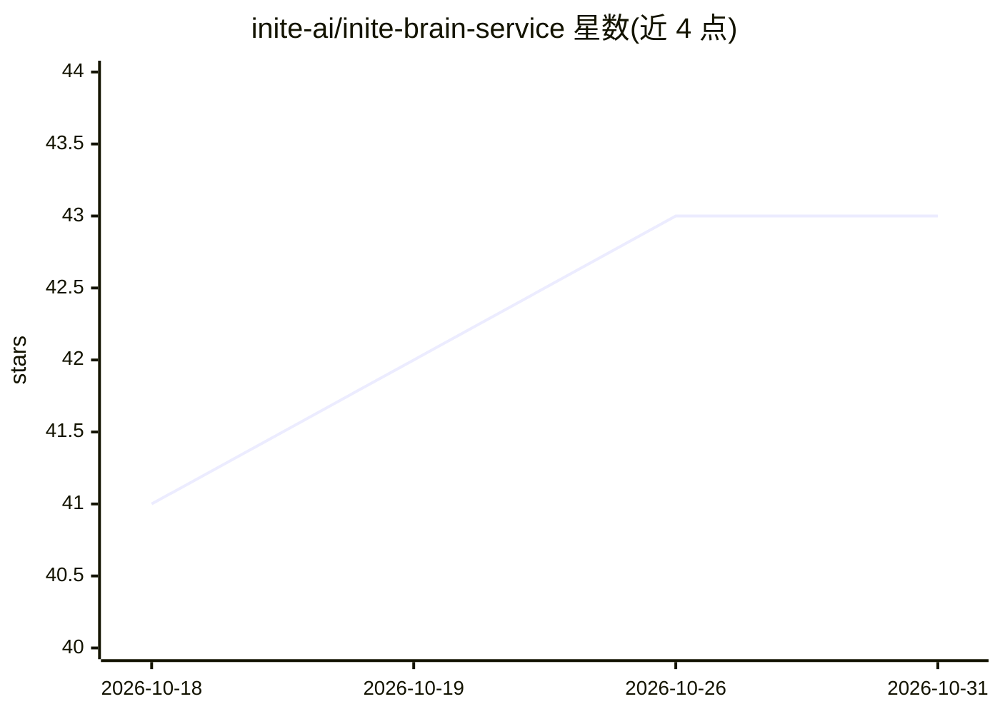

# inite-ai/inite-brain-service

⭐ 43 · TypeScript · AGPL-3.0 · 推送 2026-10-30 · [GitHub](https://github.com/inite-ai/inite-brain-service) · [官网](https://brain.inite.ai) · 组织维护

**给 AI agent 的双时态知识图谱长期记忆服务**

开源的 agent 记忆服务：以双时态（有效时间+知识时间）知识图谱存储结构化事实与关系，保留来源对话、文档、证据片段；冲突写入会取代旧事实或标记为 COMPETING 而非静默覆盖；提供混合检索、图检索、多跳查询与带引用校验、可弃答的 synthesize；每租户独立数据库、分级 key、PII 控制与 GDPR forget_entity。通过 REST 与原生 MCP（含 Claude Code、Cursor、VS Code 等 MCP 客户端）接入，支持 Docker 镜像自托管或托管服务，NestJS + SurrealDB 实现；Domain Packs 以 JSON 清单方式适配行业词汇与生命周期。默认模型配置需 OpenAI API key，首次启动下载本地 ONNX 模型。

## 筛选速览

| 维度 | 判定 | 备注 |
|---|---|---|
| AI 角色 | `ai-ecosystem` | LLM/agent 周边工具 |
| 许可风险 | `viral` | AGPL-3.0 |
| 部署形态 | `self-host` | docker 或自建部署 |
| 模型依赖 | — | README 未给出锁定关系 |
| 硬件要求 | — | 无带数字的原话,不猜 |
| 安装摩擦 | `low` | 无编译、无系统依赖或容器化 |
| 成熟度 | — | 结构信号不足 |

## 能力要点

- 双时态事实存储：冲突标记 COMPETING、retraction 保留历史、GDPR forget_entity 留墓碑
- 混合检索 + 图扩展 + 多跳查询，synthesize 逐条引用事实 id 并校验，支持不足时弃答
- REST + 原生 MCP（Streamable HTTP / stdio shim），兼容 Claude Code、Cursor、VS Code 等客户端
- Domain Packs（real_estate/fintech/medical/legal/insurance/hr）按租户安装，可签名、校验和锁定发布

## 适用场景

- 让我的 agent 在多次对话间记住事实、事件与决策及其来源
- 合规场景下按租户隔离记忆并执行 GDPR 删除
- 用行业 Domain Pack 把记忆结构对准自己的业务词汇与状态机
- 团队工程记忆：record_decision/why 保留代码决策与理由

## 场景标签

`Agent 记忆` `知识图谱` · 领域:Agent 开发

## 证据(README 行号)

> L7:  Open-source memory for AI agents: a bitemporal knowledge graph with provenance, over MCP and REST.
> L88: Brain gives an agent memory between conversations: what was said, what changed,
> L45: or point an MCP client at `http://localhost:3030/mcp` with

## 星数曲线

2026-10-18 41 → 2026-10-31 43（+2）

---
*卡片 v1 · prompt 1.4 · 生成 2026-10-25 · 置信度 mid · 依据 README sha `d262f17d4edd` · [字段定义](../../DATASET.md)*
