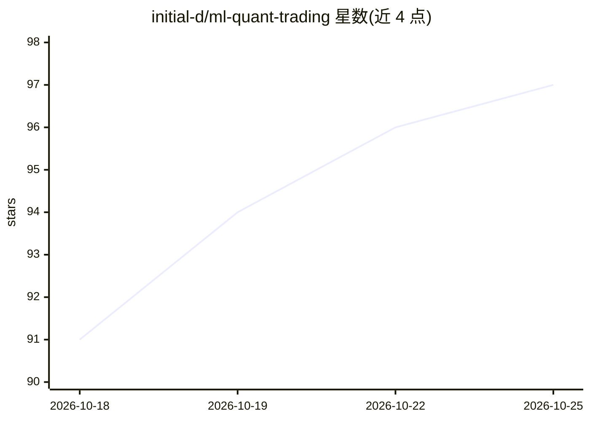

# initial-d/ml-quant-trading

⭐ 97 · Python · MIT · 推送 2026-10-25 · [GitHub](https://github.com/initial-d/ml-quant-trading) · [官网](https://initial-d.github.io/ml-quant-trading/) · 个人维护 · 中文 README

**PyTorch 横截面多因子量化研究库：213 因子到成本感知回测**

面向学生、研究人员和工程师的可复现量化研究基线（非实盘交易系统）：PyTorch 实现 213 个 mask 感知因子、限价/停牌偏差修正、MLP/Transformer 训练、Markowitz 组合构建与向量化成本感知回测，输出可审计 Markdown/JSON 报告。数据路径支持合成、AkShare、Baostock、yfinance，演示无需账户或 API key，30-90 秒 CPU 即可跑通全流程；提供类型化组合决策适配器与 DeepSeek Harness 基准插件，附 arXiv 论文与社区验证记录。限制：历史验证快照早于 v0.4.1 修正协议，README 强调非投资主张。

## 筛选速览

| 维度 | 判定 | 备注 |
|---|---|---|
| AI 角色 | `ai-native` | 本体是模型或模型工具 |
| 许可风险 | `permissive` | MIT |
| 部署形态 | `self-host` | docker 或自建部署 |
| 模型依赖 | — | README 未给出锁定关系 |
| 硬件要求 | `cpu-ok` | |
| 安装摩擦 | `low` | 无编译、无系统依赖或容器化 |
| 成熟度 | — | 结构信号不足 |

## 能力要点

- 213 个 mask 感知 PyTorch 因子（204 手工因子 + Alpha101 系列）
- 限价/停牌/可交易性偏差修正的 mask-first 因子计算协议
- 成本感知向量化回测与可复现报告（含失败与负结果）
- 类型化组合决策适配器（asset_action/target_weight/risk_bucket）

## 适用场景

- 在无需私有数据的情况下研究因子到回测的完整工作流
- 复现或扩展 A 股 CSI 300 公开数据验证
- 测试编码/量化 agent 的可复现性基准（Agent Quant Benchmark Challenge）

## 场景标签

`金融量化` · 领域:学习与行业

## 证据(README 行号)

> L52: data -> masks -> 213 factors -> model scores -> portfolio weights -> cost-aware backtest
> L244: |`mlquant.models`|MLP, Transformer, AdjMSE, IC, and RankIC losses|

## 星数曲线

2026-10-18 91 → 2026-10-25 97（+6）

---
*卡片 v1 · prompt 1.4 · 生成 2026-10-23 · 置信度 mid · 依据 README sha `3391b92f169f` · [字段定义](../../DATASET.md)*
