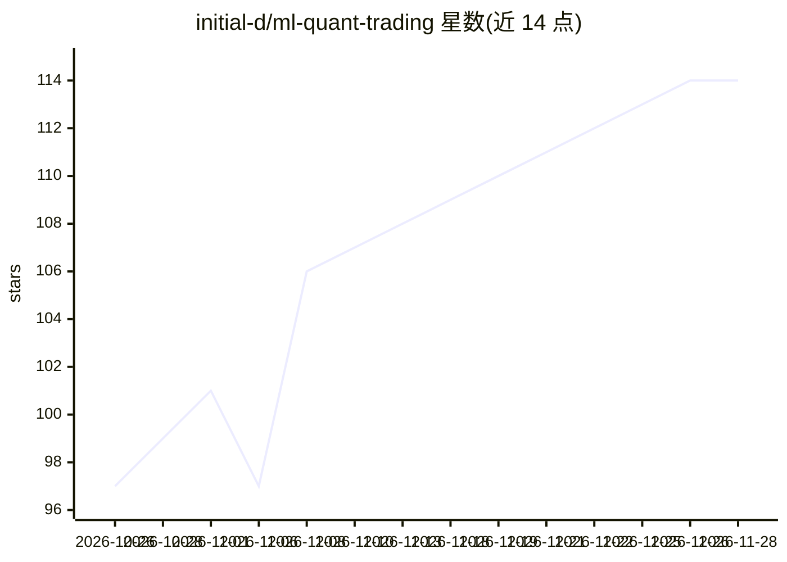

# initial-d/ml-quant-trading

⭐ 114 · Python · MIT · 推送 2026-11-27 · [GitHub](https://github.com/initial-d/ml-quant-trading) · [官网](https://initial-d.github.io/ml-quant-trading/) · 个人维护 · 中文 README

**面向量化研究者 PyTorch 横截面因子研究与回测基线**

可复现的 PyTorch 量化研究基线：覆盖 213 个 mask 感知因子（204 个手工 alpha 因子加 Alpha101 风格公式因子）、涨跌停/停牌偏差校正、Markowitz 式组合构建、成本感知回测与 Markdown/JSON 审计报告。提供合成、AkShare、Baostock、yfinance 四条数据路径，无需行情账户或 API key 即可运行 30-90 秒确定性演示。面向学生、研究者、工程师与 agent harness，附带 Colab、基准板与类型化组合决策适配器；明确声明非实盘交易系统。

## 筛选速览

| 维度 | 判定 | 备注 |
|---|---|---|
| AI 角色 | `ai-native` | 本体是模型或模型工具 |
| 许可风险 | `permissive` | MIT |
| 部署形态 | `self-host` | docker 或自建部署 |
| 模型依赖 | — | README 未给出锁定关系 |
| 硬件要求 | — | 无带数字的原话,不猜 |
| 安装摩擦 | `low` | 无编译、无系统依赖或容器化 |
| 成熟度 | — | 结构信号不足 |

## 能力要点

- 213 个 mask 感知因子与涨跌停/停牌偏差校正协议
- 合成/AkShare/Baostock/yfinance 四条数据路径，合成路径零配置零密钥
- CPU/GPU 基准板、100+ 测试与可复现报告工件
- System-One 类型化组合决策适配器与 DeepSeek Harness 基准插件

## 适用场景

- 在不接入私有数据的前提下复现完整因子到回测流程
- 对 A 股中证 300 做零认证公共数据验证
- 为编码/量化 agent 提供可复现性基准挑战
- 按成本感知方案规划调仓与容量敏感性分析

## 场景标签

`金融量化` · 领域:学习与行业

## 证据(README 行号)

> L3: **A reproducible PyTorch research stack for cross-sectional factor research:
> L94: trading system. It gives students, researchers, engineers, and agent harnesses a
> L50: data -> masks -> 213 factors -> model scores -> portfolio weights -> cost-aware backtest

## 星数曲线

2026-10-26 97 → 2026-11-28 114（+17）

---
*卡片 v1 · prompt 1.4 · 生成 2026-11-28 · 置信度 mid · 依据 README sha `067df597014a` · [字段定义](../../DATASET.md)*
