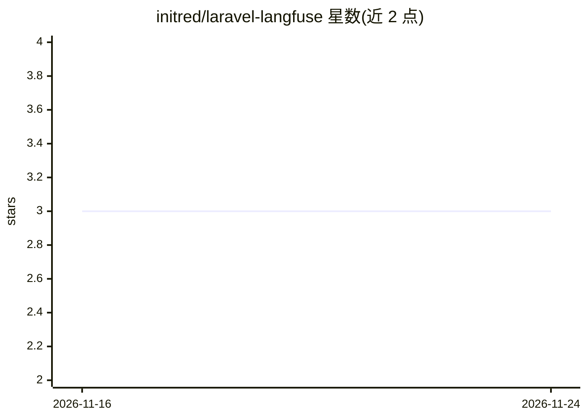

# initred/laravel-langfuse

⭐ 3 · PHP · MIT · 推送 2026-11-23 · [GitHub](https://github.com/initred/laravel-langfuse) · [官网](https://packagist.org/packages/initred/laravel-langfuse) · 个人维护

**把 Laravel 应用接入 Langfuse 可观测平台的 PHP SDK**

面向 Laravel 应用的 Langfuse SDK：通过 OpenTelemetry (OTLP) 发送 traces、generations、scores、prompts，并经 v2/v3 API 读回数据。支持零代码自动埋点（面向 Laravel AI 与 Neuron AI）、观察对象自动批量上报、可选经 Laravel 队列异步分发、stale-while-revalidate 提示词缓存、Octane 兼容与测试 fakes。要求 PHP 8.5+ 与 Laravel 13；读 API 的部分功能要求 Langfuse v4。

## 筛选速览

| 维度 | 判定 | 备注 |
|---|---|---|
| AI 角色 | `ai-ecosystem` | LLM/agent 周边工具 |
| 许可风险 | `permissive` | MIT |
| 部署形态 | `None` |  |
| 模型依赖 | — | README 未给出锁定关系 |
| 硬件要求 | — | 无带数字的原话,不猜 |
| 安装摩擦 | `low` | 无编译、无系统依赖或容器化 |
| 成熟度 | — | 结构信号不足 |

## 能力要点

- 对 Laravel AI 与 Neuron AI 提供零代码自动埋点
- 观察对象自动批量经 OTLP 上报，支持 Laravel 队列异步分发
- 提示词的获取、缓存、编译与版本管理
- 支持读取 scores/observations/指标与实验工作流 API

## 适用场景

- 追踪 Laravel 应用中每次 LLM 调用与 token 用量
- 为 LLM 输出建立评分与实验评估工作流
- 管理提示词版本并缓存拉取

## 场景标签

`LLM 可观测性` `提示工程` · 领域:Agent 开发

## 证据(README 行号)

> L11: Langfuse is an open-source observability platform for LLM applications. It gives you a dashboard to trace every LLM
> L13: This package connects your Laravel app to Langfuse, and is kept current with the latest Laravel AI SDK (`laravel/ai
> L22: Observations are batched and flushed automatically. Zero-code auto-instrumentation is available for Laravel AI and 

## 星数曲线

2026-11-16 3 → 2026-11-24 3（+0）

---
*卡片 v1 · prompt 1.4 · 生成 2026-11-21 · 置信度 high · 依据 README sha `e60922027aab` · [字段定义](../../DATASET.md)*
