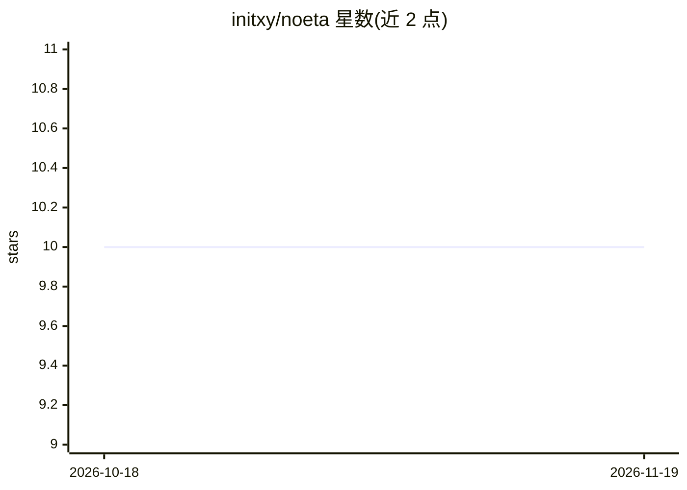

# initxy/noeta

⭐ 10 · Python · Apache-2.0 · 推送 2026-11-15 · [GitHub](https://github.com/initxy/noeta) · [官网](https://initxy.github.io/noeta/) · 个人维护 · 中文 README

**自托管的 Claude Code 兼容编码 agent，多 worker 运行**

noeta 是一个可自托管的编码 agent：对模型呈现 Claude Code 的工具、提示规则与请求格式，从而复用其上训练出的习惯以及 Claude Code 的设置、hooks、skills、MCP 等配置。核心机制是事件溯源：每个任务是一份存储中的日志，任意数量 worker 指向同一 Postgres，任何 worker 可接续任意任务；等待人工批准的任务不占用进程。单机可用 SQLite 运行，通过 TUI、CLI、ACP、HTTP/WebSocket API 与 Python SDK 接入，Apache-2.0 许可。

## 筛选速览

| 维度 | 判定 | 备注 |
|---|---|---|
| AI 角色 | `ai-ecosystem` | LLM/agent 周边工具 |
| 许可风险 | `permissive` | Apache-2.0 |
| 部署形态 | `self-host` | docker 或自建部署 |
| 模型依赖 | locked-api |  |
| 硬件要求 | — | 无带数字的原话,不猜 |
| 安装摩擦 | `low` | 无编译、无系统依赖或容器化 |
| 成熟度 | — | 结构信号不足 |

## 能力要点

- Claude Code 兼容层：工具 schema、提示规则与设置/hooks/skills/MCP 格式互通，并带 parity 回放校验
- 事件溯源任务存储：一个 Postgres 多 worker 接续任意任务，等待审批不持有进程
- 接入方式覆盖 TUI/CLI/ACP/HTTP·WebSocket/Python SDK，另有实验性 web 与桌面应用
- 插件化架构：文件、shell、权限、hooks、记忆、压缩均走统一 Extension 接口

## 适用场景

- 在多台机器上自托管编码 agent 并让任务在 worker 间自动迁移
- 用已有的 Claude Code 配置（hooks/skills/MCP）驱动非 Claude 模型
- 把编码 agent 嵌入自己的 Python 程序或通过 HTTP API 集成
- 在笔记本上用 SQLite 单进程方式本地运行 agent

## 场景标签

`编码 Agent` · 领域:编码与开发

## 证据(README 行号)

> L19: **noeta** is a coding agent that looks like Claude Code to the model and runs like a server
> L22: skills, agents, MCP servers and plugins work too. Underneath, every task is a log in a store:
> L46: - 🔌 **Every way in.** A full-screen terminal UI, Claude Code's `-p` and `stream-json`

## 星数曲线

2026-10-18 10 → 2026-11-19 10（+0）

---
*卡片 v1 · prompt 1.4 · 生成 2026-11-19 · 置信度 high · 依据 README sha `512242e5712c` · [字段定义](../../DATASET.md)*
