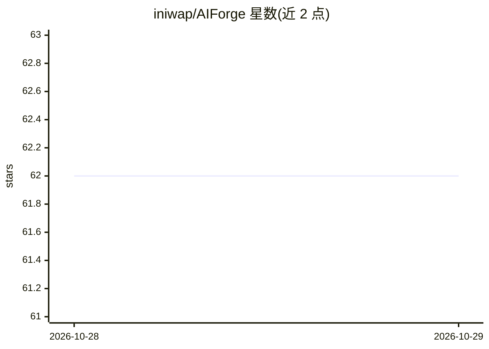

# iniwap/AIForge

⭐ 62 · Python · Apache-2.0 · 推送 2026-10-27 · [GitHub](https://github.com/iniwap/AIForge) · 个人维护 · 中文 README

**自然语言转可执行代码的智能执行引擎，覆盖数据分析与自动化**

将自然语言指令转化为可执行代码的 AI 驱动引擎，面向希望用一句话完成数据分析、内容创作、可视化与自动化工作流的用户。核心机制包括语义缓存（基于指令相似性复用代码）、模板系统、多引擎搜索集成与沙盒隔离安全执行。提供 CLI、Python API、FastAPI Web API 与桌面 GUI 四种界面，支持 Docker/K8S/多云部署。多 LLM 支持（OpenRouter/DeepSeek/Ollama）。README 声明项目处于全力开发阶段、版本更新频繁。

## 筛选速览

| 维度 | 判定 | 备注 |
|---|---|---|
| AI 角色 | `ai-native` | 本体是模型或模型工具 |
| 许可风险 | `permissive` | Apache-2.0 |
| 部署形态 | `library` | 以包/库形式分发 |
| 模型依赖 | local-ok | 支持本地模型 |
| 硬件要求 | — | 无带数字的原话,不猜 |
| 安装摩擦 | `low` | 无编译、无系统依赖或容器化 |
| 成熟度 | `idea` | |

## 能力要点

- 自然语言指令→代码生成→沙盒隔离执行
- CLI/Python API/Web API/桌面 GUI 多界面
- 语义缓存与领域模板的代码复用
- 支持 Docker、K8S 及 AWS/Azure/GCP/阿里云部署命令

## 适用场景

- 用一句话让引擎完成数据分析并生成报告
- 搭建自然语言驱动的自动化工作流服务
- 作为 Python 库集成到应用中调用 AI 执行能力

## 场景标签

`Agent 框架` `数据分析` `工作流自动化` · 领域:Agent 开发

## 证据(README 行号)

> L8: **将自然语言指令转化为可执行代码的AI驱动自动化引擎**
> L20: - 🎭 **多 LLM 支持**：OpenAI、DeepSeek、OpenRouter、Ollama

## 星数曲线

2026-10-28 62 → 2026-10-29 62（+0）

---
*卡片 v1 · prompt 1.4 · 生成 2026-10-28 · 置信度 high · 依据 README sha `d6c4d63964e3` · [字段定义](../../DATASET.md)*
