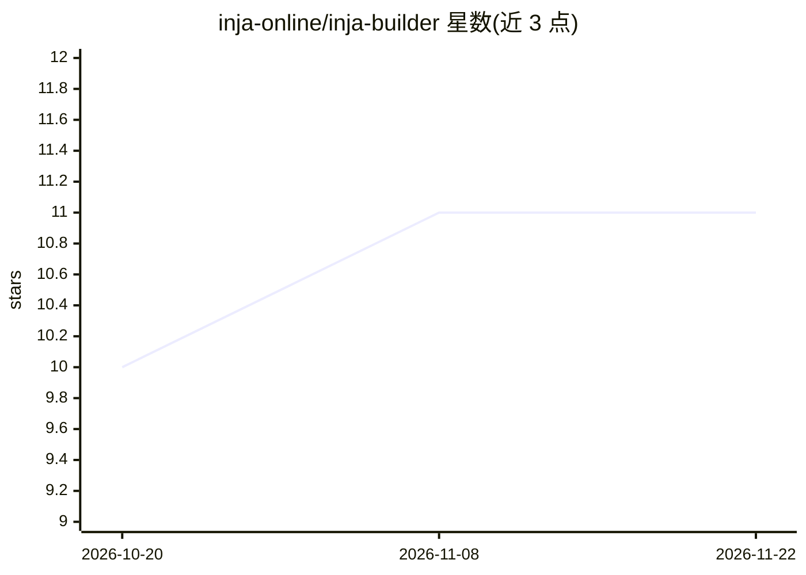

# inja-online/inja-builder

⭐ 11 · Svelte · AGPL-3.0 · 推送 2025-12-03 · [GitHub](https://github.com/inja-online/inja-builder) · [官网](https://builder.inja.online) · 个人维护

**AI 网页生成平台：自然语言描述生成完整 HTML 网站**

基于 SvelteKit 5 的网页生成平台，用户输入自然语言描述后由 AI 生成单文件 HTML 网站（使用 Alpine.js、Tailwind CSS、Lucide Icons），支持分栏实时预览、对话式迭代修改与 HTML 导出。推理通过 OpenRouter 调用 Cerebras API。README 给出 Node.js 18+ 环境下的 git clone 与 npm 安装流程，需自备 OpenRouter API key，部署目标为 Cloudflare Pages。

## 筛选速览

| 维度 | 判定 | 备注 |
|---|---|---|
| AI 角色 | `ai-native` | 本体是模型或模型工具 |
| 许可风险 | `viral` | AGPL-3.0 |
| 部署形态 | `library` | 以包/库形式分发 |
| 模型依赖 | locked-api |  |
| 硬件要求 | — | 无带数字的原话,不猜 |
| 安装摩擦 | `low` | 无编译、无系统依赖或容器化 |
| 成熟度 | — | 结构信号不足 |

## 能力要点

- 自然语言生成完整、自包含的单文件 HTML 网站
- 对话式界面支持迭代修改生成结果
- 分栏实时预览生成网页
- 通过 OpenRouter 调用 Cerebras API 进行推理

## 适用场景

- 快速生成网站原型和模型稿
- 参考生成的代码学习现代网页开发模式
- 为客户演示快速生成页面

## 场景标签

`代码生成` · 领域:编码与开发

## 证据(README 行号)

> L11: BUILDER.INJA.ONLINE is an innovative web builder that leverages artificial intelligence to generate complete, respo
> L15: - **Natural Language to Code**: Describe your website idea and get a complete HTML implementation
> L25: 2. **AI Generation**: The Cerebras-powered AI analyzes your request and generates clean HTML code

## 星数曲线

2026-10-20 10 → 2026-11-22 11（+1）

---
*卡片 v1 · prompt 1.4 · 生成 2026-11-18 · 置信度 high · 依据 README sha `cedb8a2d937f` · [字段定义](../../DATASET.md)*
