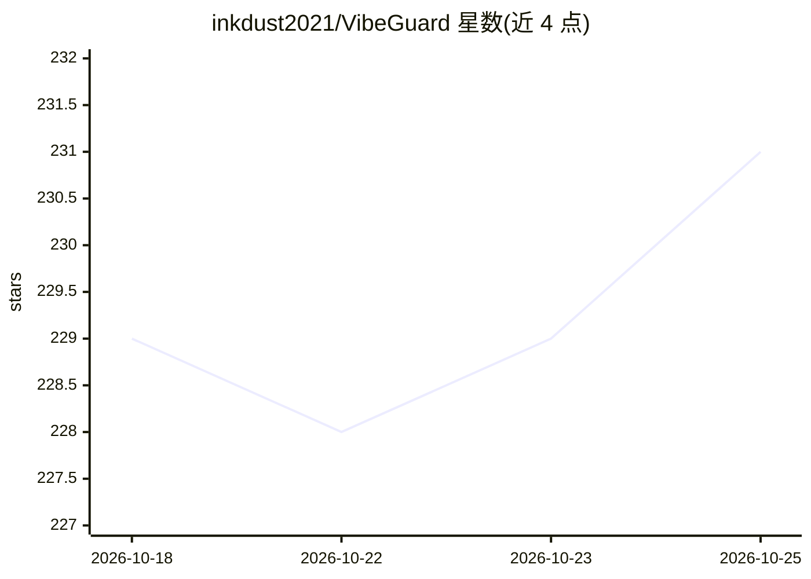

# inkdust2021/VibeGuard

⭐ 232 · Go · Apache-2.0 · 推送 2026-10-09 · [GitHub](https://github.com/inkdust2021/VibeGuard) · [官网](https://vibeguard.top/) · 个人维护 · 中文 README

**面向 vibecoding 的本地 MITM 代理：拦截并脱敏发往 AI API 的敏感数据**

用 Go 编写的轻量 MITM HTTPS 代理，部署在编码 CLI/IDE 与上游 AI API 之间，按规则列表、关键词精确匹配及可选 NER 对文本类请求体（上限 10MB）做本地匹配与脱敏，仅转发脱敏后内容。提供 Admin UI 配置规则/证书/会话并审计每次请求的脱敏命中；支持 .vgrules 订阅、.env 密钥文件导入、静默加密存储与热重载。安装脚本支持 Mac/Linux/Windows，可用 vibeguard claude/codex/qwen 等方式包裹命令或设为系统代理，另有 Docker 镜像。

## 筛选速览

| 维度 | 判定 | 备注 |
|---|---|---|
| AI 角色 | `ai-ecosystem` | LLM/agent 周边工具 |
| 许可风险 | `permissive` | Apache-2.0 |
| 部署形态 | `None` |  |
| 模型依赖 | — | README 未给出锁定关系 |
| 硬件要求 | — | 无带数字的原话,不猜 |
| 安装摩擦 | `low` | 无编译、无系统依赖或容器化 |
| 成熟度 | — | 结构信号不足 |

## 能力要点

- 规则列表+关键词+可选 NER 的本地脱敏管线，不回传原始敏感内容
- Admin UI 支持规则/证书/会话配置、逐请求审计与日志查看，密码保护
- vibeguard claude/codex/qwen/gemini 一键包裹命令，或 IDE 设代理 127.0.0.1:28657
- 关键词静默加密存储、.env 密钥文件自动脱敏、配置热重载

## 适用场景

- vibecoding 时防止 API key、密码等敏感信息被发送到 AI 服务
- 为 Claude Code / Codex / OpenCode 等 AI 编码工具统一加脱敏层
- 在 Admin UI 审计每条请求的脱敏命中情况

## 场景标签

`网络安全` · 领域:学习与行业

## 证据(README 行号)

> L23: VibeGuard is a lightweight MITM HTTPS proxy for protecting sensitive data when vibecoding. It aims to be out-of-the
> L25: **Privacy statement**: VibeGuard matches/redacts locally. It does not upload your raw sensitive content to any Vibe

## 星数曲线

2026-10-18 229 → 2026-10-25 231（+2）

---
*卡片 v1 · prompt 1.4 · 生成 2026-10-22 · 置信度 high · 依据 README sha `1daa8b0f0e2e` · [字段定义](../../DATASET.md)*
