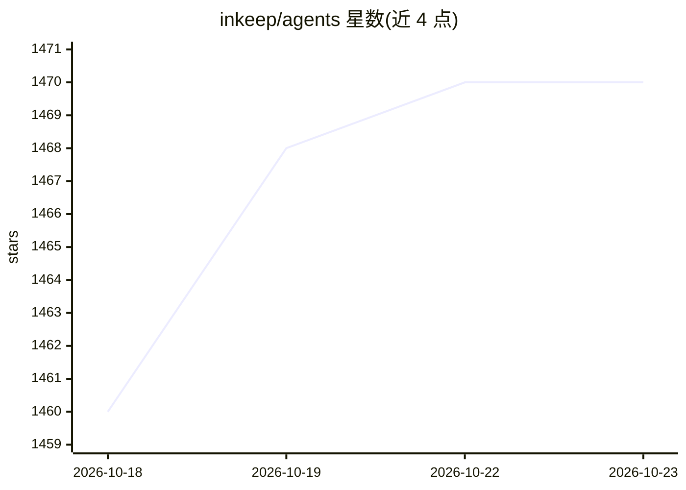

# inkeep/agents

⭐ 1,470 · TypeScript · NOASSERTION · 推送 2026-10-21 · [GitHub](https://github.com/inkeep/agents) · [官网](https://docs.inkeep.com) · 组织维护

**可视化+TypeScript 双模式构建 AI Agent 的开发平台**

提供拖拽式可视化构建器与 TypeScript SDK，两者可双向同步，供技术与非技术团队在同一平台创建和管理 Agent。平台包含 agents-api（配置与执行）、可视化界面、SDK、CLI 与聊天 UI 组件库；支持多 Agent 架构、带凭据管理的 MCP 工具、通过 MCP/A2A/Vercel SDK API 触发 Agent，以及基于 Traces UI 与 OpenTelemetry 的可观测性。底层使用 Vercel AI SDK 对接 LLM 提供商。可经 Vercel 或 Docker 部署。许可为 Elastic License 2.0 附加补充条款的 fair-code 许可，限制部分竞争性用途。

## 筛选速览

| 维度 | 判定 | 备注 |
|---|---|---|
| AI 角色 | `ai-ecosystem` | LLM/agent 周边工具 |
| 许可风险 | `none` | NOASSERTION |
| 部署形态 | `None` |  |
| 模型依赖 | — | README 未给出锁定关系 |
| 硬件要求 | — | 无带数字的原话,不猜 |
| 安装摩擦 | `low` | 无编译、无系统依赖或容器化 |
| 成熟度 | — | 结构信号不足 |

## 能力要点

- 可视化构建器与 TypeScript SDK 全量双向同步
- 多 Agent 架构与带凭据管理的 MCP 工具
- 通过 MCP、A2A 与 Vercel SDK API 触发 Agent
- Traces UI 与 OpenTelemetry 可观测性，支持 Vercel 或 Docker 部署

## 适用场景

- 为帮助中心和技术文档构建 AI 聊天助手
- 团队内部 copilot 辅助支持、销售与运营工作
- 用 Agent 自动化知识库更新、CRM 维护与工单分派

## 场景标签

`Agent 框架` `多智能体` · 领域:Agent 开发

## 证据(README 行号)

> L3: Build AI Agents with a **No-Code Visual Builder** or **TypeScript SDK**. Agents can be edited in either with **full 
> L62: - **agents-api**: An API that handles configuration of Agents, Sub Agents, MCP Servers, Credentials, and Projects w

## 星数曲线

2026-10-18 1,460 → 2026-10-23 1,470（+10）

---
*卡片 v1 · prompt 1.4 · 生成 2026-10-21 · 置信度 high · 依据 README sha `7ba7b7c6c4b7` · [字段定义](../../DATASET.md)*
