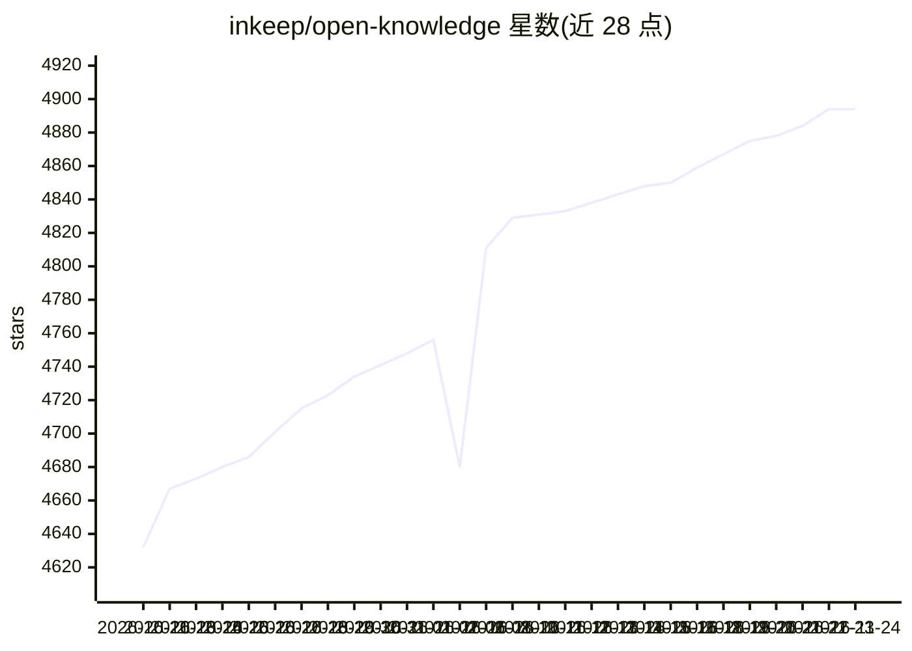

# inkeep/open-knowledge

⭐ 4,897 · TypeScript · GPL-3.0 · 推送 2026-11-23 · [GitHub](https://github.com/inkeep/open-knowledge) · [官网](https://openknowledge.ai) · 组织维护

**给知识库/wiki 使用者的 AI 原生 Markdown 编辑器**

OpenKnowledge 是一款所见即所得的 Markdown/MDX 编辑器，提供 macOS/Windows/Linux 桌面应用与基于 Node.js CLI 的本地 Web UI 两种形态，内含文件导航、搜索、标签页、wiki 链接图谱等编辑器功能。可打开本地任意 markdown 文件夹（含 Obsidian vault、代码库 docs）。AI 部分：与 Claude、Codex、OpenCode 等 agent harness 并排集成编辑，开箱提供 MCP、skills 与 agentic search，并引导用户为检测到的 harness 安装 MCP 与技能；支持基于 git/GitHub 的团队分享与同步。采用 GPLv3+ 许可。

## 筛选速览

| 维度 | 判定 | 备注 |
|---|---|---|
| AI 角色 | `ai-enhanced` | 去掉 AI 部分产品仍成立 |
| 许可风险 | `viral` | GPL-3.0 |
| 部署形态 | `library` | 以包/库形式分发 |
| 模型依赖 | locked-api |  |
| 硬件要求 | — | 无带数字的原话,不猜 |
| 安装摩擦 | `low` | 无编译、无系统依赖或容器化 |
| 成熟度 | — | 结构信号不足 |

## 能力要点

- 所见即所得 Markdown/MDX 编辑，带 wiki 链接图谱与嵌入 HTML 组件
- 与 Claude、Codex、OpenCode 等 harness 并排集成 AI 编辑，经 MCP/CLI 接入任意 agent
- 开箱提供 MCP、skills 与 agentic search，面向 LLM wiki 与第二大脑
- 桌面应用（macOS/Windows/Linux）+ CLI 启动的本地 Web UI，git/GitHub 同步分享

## 适用场景

- 搭建团队或个人的 LLM wiki 与知识库
- 让 Claude Code 等 agent 检索并撰写项目文档
- 替代传统编辑器处理 Obsidian vault 或代码库 docs

## 场景标签

`知识库管理` · 领域:知识与检索

## 证据(README 行号)

> L6:  OpenKnowledge is a beautiful markdown editor with integrations with Claude, Codex, and other harnesses. For knowled
> L30: - Integrated **side-by-side AI-editing** with **Claude, Codex, OpenCode, Pi and others**. Can be used with any harn
> L58: You can use it simply as a rich, WYSIWYG markdown editor to start. For existing files or plain notes/docs.

## 星数曲线

2026-10-21 4,632 → 2026-11-24 4,894（+262）

---
*卡片 v1 · prompt 1.4 · 生成 2026-11-22 · 置信度 high · 依据 README sha `2a8a63f43411` · [字段定义](../../DATASET.md)*
