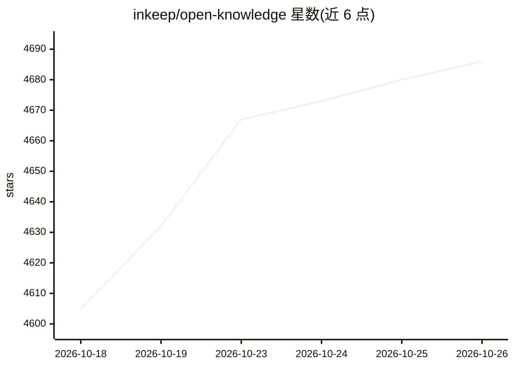

# inkeep/open-knowledge

⭐ 4,686 · TypeScript · GPL-3.0 · 推送 2026-10-25 · [GitHub](https://github.com/inkeep/open-knowledge) · [官网](https://openknowledge.ai) · 组织维护

**面向知识库与 LLM wiki 的本地 markdown IDE，集成多家 AI 编辑器**

私有、本地运行的 markdown 编辑器，定位'Notion 遇上 VS Code'：提供 WYSIWYG 编辑、桌面应用（macOS/Windows/Linux）与 Web UI，含文件导航、搜索、标签页与图谱式 wiki 链接视图。AI 部分为与 Claude、Codex、OpenCode、Pi 等 harness 的并排协同编辑，可通过 MCP/CLI 接入任意 agent，并为检测到的 agent 编辑器安装 MCP 与技能，辅助检索和写作；同步与团队共享基于 git/GitHub。由 Inkeep 公司维护，GPLv3 许可。

## 筛选速览

| 维度 | 判定 | 备注 |
|---|---|---|
| AI 角色 | `ai-enhanced` | 去掉 AI 部分产品仍成立 |
| 许可风险 | `viral` | GPL-3.0 |
| 部署形态 | `library` | 以包/库形式分发 |
| 模型依赖 | locked-api |  |
| 硬件要求 | — | 无带数字的原话,不猜 |
| 安装摩擦 | `low` | 无编译、无系统依赖或容器化 |
| 成熟度 | — | 结构信号不足 |

## 能力要点

- WYSIWYG markdown 编辑，桌面应用与 Web UI 双形态
- 与 Claude、Codex、OpenCode、Pi 等 harness 并排 AI 协同编辑
- 开箱即用 MCP、skills 与 agentic search（LLM wiki/第二大脑/知识图谱）
- 基于 git/GitHub 的团队共享与自动同步

## 适用场景

- 把 Obsidian vault、代码库或既有文档当知识库编辑管理
- 搭建 LLM wiki 或第二大脑，让 agent 检索和撰写文档
- 团队通过 git/GitHub 同步共享工程规格与笔记

## 场景标签

`知识库管理` · 领域:知识与检索

## 证据(README 行号)

> L6:  OpenKnowledge is a beautiful markdown editor with integrations with Claude, Codex, and other harnesses. For knowled
> L30: - Integrated **side-by-side AI-editing** with **Claude, Codex, OpenCode, Pi and others**. Can be used with any harn
> L31: - Out-of-the-box **MCP**, **skills**, and **agentic search** for LLM Wikis, second brains, and knowledge graphs.

## 星数曲线

2026-10-18 4,605 → 2026-10-26 4,686（+81）

---
*卡片 v1 · prompt 1.4 · 生成 2026-10-20 · 置信度 mid · 依据 README sha `b75ea50f0c10` · [字段定义](../../DATASET.md)*
