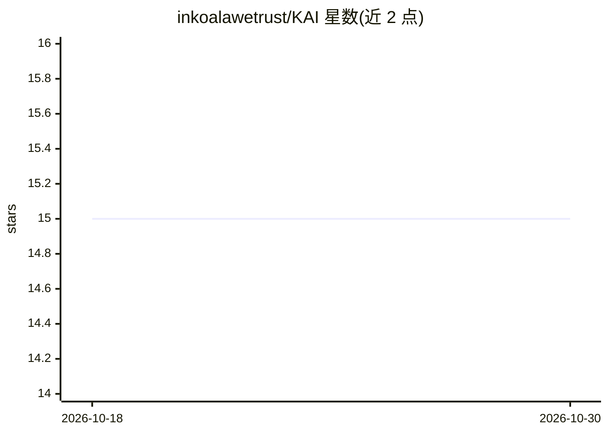

# inkoalawetrust/KAI

⭐ 15 · GPL-3.0 · 推送 2026-07-23 · [GitHub](https://github.com/inkoalawetrust/KAI) · 个人维护

**给 UZDoom 模组开发者创建智能 Doom NPC 的 ZScript AI 库**

面向 UZDoom 引擎的 ZScript 模组库，提供大量虚函数/非虚函数、mixins 与可继承的基础 NPC 类，供模组开发者制作自定义智能怪物；本身不是独立玩法模组，被依赖加载后不改变游戏内容。同一库版本下的不同模组 NPC 可互相交互，未依赖 KAI 的模组也有部分兼容性。获取方式为下载编号 release 或最新 commit 的源码 ZIP，文档位于外部 wiki。作者声明库处于早期 alpha，大量功能待补（载具乘客系统、部位伤害等）。

## 筛选速览

| 维度 | 判定 | 备注 |
|---|---|---|
| AI 角色 | `ai-native` | 本体是模型或模型工具 |
| 许可风险 | `viral` | GPL-3.0 |
| 部署形态 | `None` |  |
| 模型依赖 | — | README 未给出锁定关系 |
| 硬件要求 | — | 无带数字的原话,不猜 |
| 安装摩擦 | `low` | 无编译、无系统依赖或容器化 |
| 成熟度 | `idea` | |

## 能力要点

- 内置多个可继承的基础 NPC 类、mixins 与大量虚/非虚函数
- 不同模组的 NPC 使用同一库时可互相交互，无需专用补丁
- 未依赖 KAI 的模组也保有部分兼容性，无需强制同库加载
- 作者自述处于早期 alpha，功能仍在变动

## 适用场景

- 为 UZDoom 模组开发带自定义 AI 的 Doom NPC
- 让多个模组的 NPC 之间实现跨模组交互
- 统一多个模组项目共用的 NPC 基础 AI 代码

## 场景标签

 · 领域:游戏/模组开发

## 证据(README 行号)

> L1: # Koala AI Library
> L7: The KAI's purpose is to allow for an easier way for modders to make intelligent NPCs in UZDoom. By coming built-in w
> L18: KAI is a library for other modders to use in order to make custom monsters, it's not a gameplay mod that does anyth

## 星数曲线

2026-10-18 15 → 2026-10-30 15（+0）

---
*卡片 v1 · prompt 1.4 · 生成 2026-10-30 · 置信度 high · 依据 README sha `a2f15c3c563d` · [字段定义](../../DATASET.md)*
